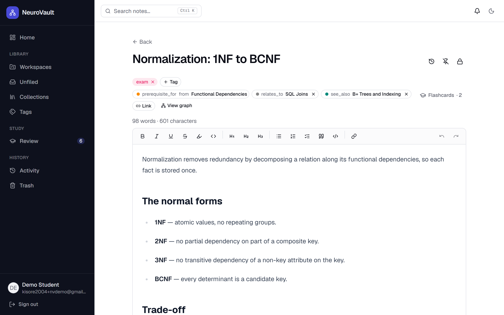
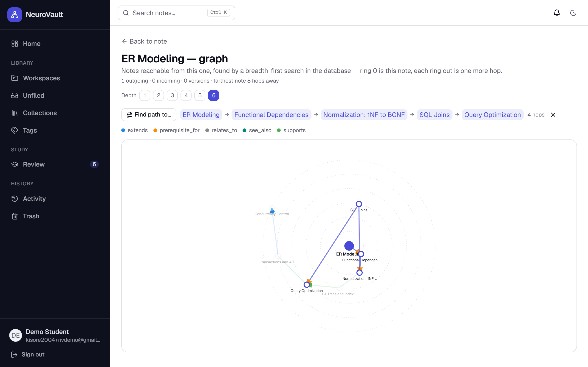
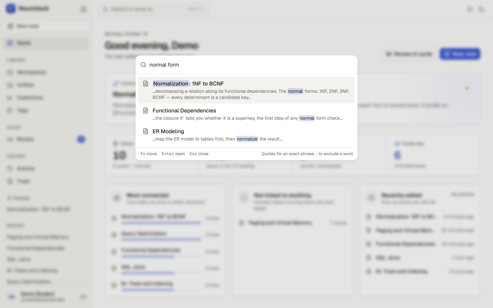
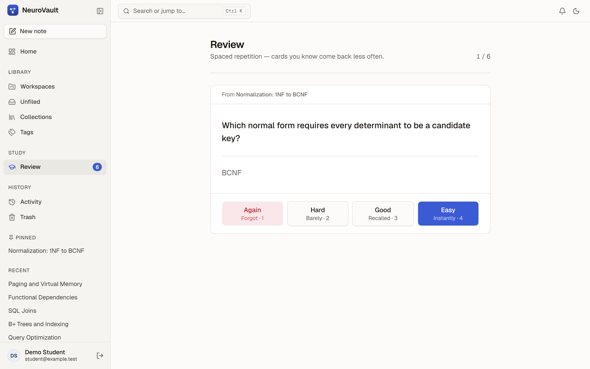
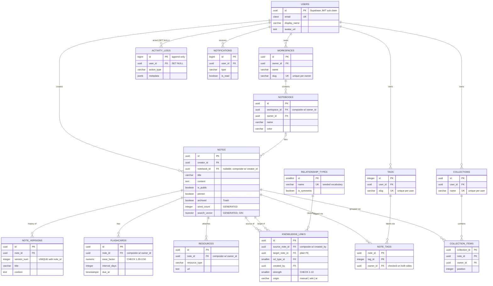
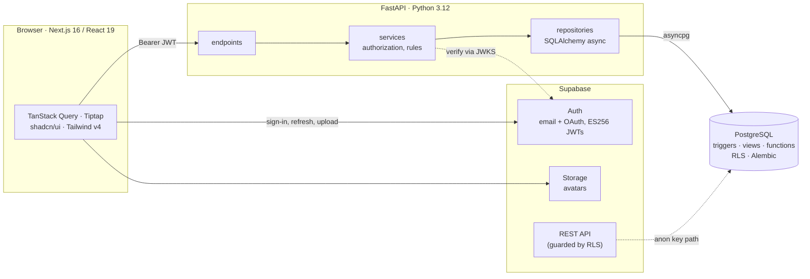
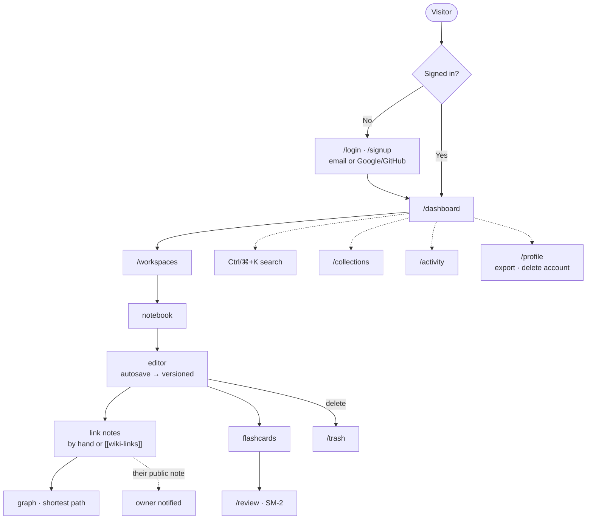

<div align="center">

# NeuroVault

**A knowledge base where notes form a graph — and PostgreSQL does the heavy lifting.**

[](https://github.com/Mahakisore7/Neuro_Vault/actions/workflows/ci.yml)
[](LICENSE)


</div>

Most note apps give you two structures: folders (a hierarchy) and tags (a set). NeuroVault
adds a third — **typed, directed links between notes** (*supports*, *contradicts*,
*prerequisite for* …), stored in a self-referencing table that the database traverses
itself. Write notes, connect them, and explore what's within a few hops, find the shortest
route between two ideas, or review what you've learned with spaced-repetition flashcards.

It was built as a DBMS course project, so the design goal is a schema where **the database
enforces and computes, not just stores**: tenancy enforced by composite foreign keys,
version history and an audit log written by triggers, ranked full-text search on a GIN
index, graph traversal as a database function, and row level security as the last line of
defence.


<table>
  <tr>
    <td width="50%"><br><sub><b>Note</b>: tags, typed links in both directions, a <code>[[wiki-link]]</code>, flashcards</sub></td>
    <td width="50%"><br><sub><b>Graph</b>: breadth-first search in PL/pgSQL, shortest path highlighted</sub></td>
  </tr>
  <tr>
    <td width="50%"><br><sub><b>Command palette</b>: ranked full-text search on a GIN index, matches highlighted</sub></td>
    <td width="50%"><br><sub><b>Review</b>: SM-2 spaced repetition</sub></td>
  </tr>
</table>

<sub>Screenshots are the production build with sample DBMS notes, light theme. Every screen
also has a dark theme.</sub>

## Contents

- [Features](#features)
- [Database highlights](#database-highlights)
- [Architecture](#architecture)
  - [Security and operations](#security-and-operations)
- [Getting started](#getting-started)
- [Testing](#testing)
- [Deployment](#deployment)
- [API](#api)
- [Project structure](#project-structure)
- [Development workflow](#development-workflow)
- [Troubleshooting](#troubleshooting)
- [Known limitations](#known-limitations)
- [Documentation](#documentation)
- [License](#license)

## Features

**Write and organise**
- Rich-text editor (Tiptap) in a distraction-free document layout: a toolbar that stays in
  view, autosave with a visible saved/unsaved state, Ctrl+S, pinning, and a public/private
  toggle per note
- **New note** from the sidebar, the home page or the command palette: one click to a
  blank page, filed later
- Workspaces → notebooks → notes, plus tags and **collections** (hand-picked, ordered
  lists that can span notebooks)
- **Version history** for every real edit, with one-click restore — and restores are
  versioned too, so you can undo an undo
- **Trash**: deleting moves a note to Trash; nothing is gone until you delete it forever

**Connect**
- **`[[wiki-links]]`**: type `[[` to pick a note, and the link appears in the graph when
  the note saves. Ctrl+click opens it, or creates it if it doesn't exist yet. Deleting
  the text removes the link, but never one you made by hand
- Typed links between notes, with a strength, including to other people's public notes
- **Graph view** of everything within 1–6 hops, with a **shortest-path finder** that
  highlights the route between two notes
- Per-note stats: links in and out, versions, distance to the farthest connected note

**Find and learn**
- **Command palette** (Ctrl/⌘+K): search notes, with phrase and exclusion syntax, ranked
  and highlighted results and a similar-titles fallback when you mistype, or jump
  anywhere, create a note, or switch theme. Press `?` for every keyboard shortcut
- **Flashcards** on any note, scheduled with the SM-2 spaced-repetition algorithm, and a
  keyboard-first review screen

**Stay oriented**
- **Home dashboard**: a summary strip, your most-connected notes (with how linked each one
  is), notes not linked to anything yet, recent edits, and a one-click way into today's
  review
- **Activity timeline** of what changed, and **notifications** when someone links to your
  public note
- Email/password or Google/GitHub sign-in, password reset by email, avatar upload
- **Designed light and dark themes**, following the system setting or your choice; a
  consistent design system (tokens for colour, spacing and elevation) across every screen,
  checked for WCAG 2.1 AA contrast
- **Your data is yours**: export everything as one JSON file, or delete the account and
  all of it permanently
- Works on phones (the sidebar becomes a slide-in menu); Move to Trash comes with Undo

## Database highlights

What makes this a database project rather than an app with a database behind it. Each
row is migrated, tested, and explained in the design docs.

| Concept | Where it lives | Why |
|---|---|---|
| **Composite foreign keys for tenancy** | Every table attached to a note carries the owner: `(note_id, owner_id) → notes(id, creator_id)` | Cross-user writes are rows PostgreSQL refuses to store, not bugs the app has to catch ([ADR-001](docs/adr/0001-tenancy-composite-foreign-keys.md)) |
| **Generated columns** | `notes.word_count`, `notes.search_vector` | Derived data can't drift from its source ([ADR-002](docs/adr/0002-generated-columns.md)) |
| **Triggers** | Version history (`BEFORE UPDATE`), activity log and notifications (`AFTER`), auth sync | Rules that must hold for every writer, not only the API ([ADR-020](docs/adr/0020-audit-triggers-skip-deleted-users.md)) |
| **Stored procedure** | `sp_rollback_note_version` | Restores through an ordinary `UPDATE`, so the rollback is itself versioned |
| **Graph traversal function** | `fn_note_distances` (breadth-first search), `fn_shortest_path`, `fn_max_graph_depth` | Each note expanded once; the textbook recursive CTE enumerates every path ([ADR-021](docs/adr/0021-graph-traversal-is-breadth-first.md)) |
| **Views** | `v_user_dashboard`, `v_note_graph_stats`, `v_orphan_notes`, `v_note_search` | One definition per aggregate; `security_invoker` so RLS still applies ([ADR-022](docs/adr/0022-views-are-security-invoker.md)) |
| **Full-text and fuzzy search** | GIN on `tsvector`, `websearch_to_tsquery`, `ts_rank_cd`; GIN trigram index for typos | Inverted indexes answer "which rows contain this word" — a B-tree can't |
| **Purpose-built indexes** | Partial (live notes, unread notifications), composite in `ORDER BY` order | Every index serves a named query and has an `EXPLAIN` test; two planned ones were dropped as redundant |
| **Window functions** | Activity feed collapses autosave bursts (gaps-and-islands with `LAG` + running `SUM`) | Merge at read time, keep the log complete |
| **Provenance column** | `knowledge_links.origin CHECK IN ('manual','wiki','ai')` | `[[wiki-link]]` sync deletes and inserts only `origin = 'wiki'` rows (one `DELETE`, one `INSERT … SELECT unnest(…)`, titles resolved with `DISTINCT ON`), so links made by hand are never touched |
| **Set-based export, transactional delete** | Account export is one statement of `jsonb_agg` per table; account delete removes the app rows (cascading) and the login in one transaction | A full backup in one round trip; a delete can't leave a login without data or data without a login |
| **Exact arithmetic + `CHECK`** | SM-2 `ease_factor NUMERIC(4,2) CHECK (1.30–2.50)` | The algorithm's own bounds, enforced by the table |
| **Row level security** | Per-user policies on every table, `TO authenticated` | Protects the one path that skips the API: the browser's anon key ([ADR-008](docs/adr/0008-row-level-security.md), [ADR-023](docs/adr/0023-rls-policies-as-built.md)) |

<details>
<summary><b>Entity-relationship diagram</b> (15 tables)</summary>

`PK` primary key · `FK` foreign key · `UK` unique. Every relationship into `notes`,
`notebooks`, `note_tags` and `collection_items` is a composite FK that carries the owner.



The two `NOTES → KNOWLEDGE_LINKS` relationships are the graph: a self-referencing
many-to-many on `notes`, deliberately asymmetric. The source side requires that you own
the note; the target side lets you point at any note you can read
([ADR-007](docs/adr/0007-links-originate-from-owned-notes.md)).

</details>

## Architecture



- **Supabase owns identity, FastAPI owns the domain.** Password hashing, OAuth and token
  refresh stay with Supabase Auth. Authorization rules and every query go through
  FastAPI's endpoint → service → repository layers. The JWT is the only handoff: FastAPI
  never sees a password, and Supabase never sees a note.
- **No login routes in the backend.** A new account is mirrored into `public.users` by a
  trigger on `auth.users` ([ADR-017](docs/adr/0017-auth-users-trigger-not-webhook.md)).
- **Two enforcement points.** Requests through FastAPI are authorized by its services.
  Anything that reaches the database directly with the browser's anon key is limited by
  row level security.

| Layer | Stack |
|---|---|
| Frontend | Next.js 16 (App Router), React 19, TypeScript, Tailwind CSS v4, shadcn/ui, Tiptap 3, TanStack Query |
| Backend | FastAPI, Pydantic v2, SQLAlchemy 2 (async) + asyncpg, Alembic, uv |
| Database | PostgreSQL 15+ (Supabase in production; Postgres 16 in CI and Docker) |
| Auth | Supabase Auth; JWTs verified in the backend via JWKS (ES256, [ADR-018](docs/adr/0018-jwt-verification-via-jwks.md)) |
| Quality | pytest against a real database, Playwright + axe browser tests, ruff, pyright, ESLint, GitHub Actions |
| Hosting | Docker image on Render (API), Vercel (web app), Supabase (database, auth, storage) |

### Security and operations

Beyond row level security and tenancy enforced by the schema:

- **Rate limiting** per client IP: 300 requests a minute overall, with tighter limits on
  export, account delete and Empty Trash. Over the limit, the API answers `429` with
  `Retry-After` ([ADR-024](docs/adr/0024-in-process-rate-limiting.md)).
- **Request IDs and structured logs.** Every response carries `X-Request-ID`, and every
  request is logged as one JSON line. An unexpected error returns a JSON `500` with that ID
  instead of a stack trace.
- **Security headers.** The API sends `nosniff`, `X-Frame-Options` and a referrer
  policy, plus HSTS in production. The web app adds a Content Security Policy that allows
  only itself, the API and Supabase ([ADR-025](docs/adr/0025-csp-without-nonces.md)).
- **JWT checks** verify signature, audience and expiry, with 30 seconds of leeway for
  clock skew between Supabase and the server.
- **Production container**: non-root, no dev dependencies or `.env` inside, applies
  migrations on start, and hides `/docs` outside development.

## Getting started

### Prerequisites

- **Python 3.12+** and [uv](https://docs.astral.sh/uv/)
- **Node.js 20.9+** (CI uses 22) and [pnpm](https://pnpm.io)
- **A [Supabase](https://supabase.com) project.** Authentication runs through Supabase
  Auth, so one is needed even when the database is local.
- *Optional:* Docker, for a fully local database

### 1. Configure

Settings are read from a `.env` file in the directory a command runs from, so the backend
needs its own copy:

```bash
cp .env.example backend/.env           # backend: uv run ... from backend/
cp .env.example .env                   # only if you use docker compose
cp frontend/.env.example frontend/.env.local
```

| Variable | File | What it is |
|---|---|---|
| `DATABASE_URL` | `backend/.env` | Postgres URL for the app, async driver: `postgresql+asyncpg://…` |
| `DATABASE_URL_SYNC` | `backend/.env` | The same database for Alembic and psql: `postgresql://…` ([ADR-004](docs/adr/0004-two-database-urls.md)) |
| `SUPABASE_URL` | `backend/.env` | Your project URL; used to fetch the JWT signing keys. Not a secret |
| `ALLOWED_ORIGINS` | `backend/.env` | CORS origins, e.g. `http://localhost:3000` |
| `ENVIRONMENT` / `DEBUG` | `backend/.env` | `development` enables `/docs` |
| `NEXT_PUBLIC_SUPABASE_URL` | `frontend/.env.local` | Same project URL |
| `NEXT_PUBLIC_SUPABASE_ANON_KEY` | `frontend/.env.local` | The **anon** key, never `service_role`: it ships to every browser |
| `NEXT_PUBLIC_API_URL` | `frontend/.env.local` | The backend, e.g. `http://localhost:8000` |

### 2. Database

**Option A: Supabase (recommended).** Put the project's Postgres connection string in
`DATABASE_URL` and `DATABASE_URL_SYNC`, then:

```bash
cd backend
uv sync
uv run alembic upgrade head
```

**Option B: fully local.** Docker Compose runs Postgres 16, applies the migrations and
starts the backend. A few migrations reach into Supabase's own schemas (`auth`,
`storage`), so a plain Postgres needs the same stand-ins CI uses. Load them once, before
the first migration:

```bash
docker compose up -d db
docker compose exec -T db psql -U neurovault -d neurovault < backend/ci/bootstrap_supabase_stubs.sql
docker compose up            # migrate, then start the API
```

### 3. Run

```bash
# terminal 1 — API on http://localhost:8000 (docs at /docs)
cd backend && uv run uvicorn app.main:app --reload

# terminal 2 — app on http://localhost:3000
cd frontend && pnpm install && pnpm dev
```

Sign up, create a workspace and a notebook, and start writing.

## Testing

```bash
cd backend && uv run pytest          # backend: unit + database tests
cd frontend && pnpm lint && pnpm type-check
cd frontend && pnpm build && pnpm test:e2e   # browser tests (Playwright + axe)
```

The backend suite runs against a **real PostgreSQL database**, because most of what it
checks lives there:
- triggers, generated columns, and `CHECK` and composite-FK constraints
- row level security, by impersonating clients exactly as Supabase's REST API does
- `EXPLAIN` checks that each query really uses its index

Each test runs inside a transaction that is always rolled back, so it is safe to point at
a development database.

The **browser tests** (`frontend/e2e/`) drive the production build in Chromium. The API
and Supabase are replaced by an in-memory fake, so they need no database or account.
They cover:
- the editor's save behaviour, including the two ways edits used to be lost;
- `[[wiki-link]]` autocomplete, Ctrl+click to create a missing note, and the link-bar
  badge for links made from the text;
- the command palette, read-only public notes, Empty Trash, and the password-reset and
  account pages;
- an **axe** WCAG 2.1 AA accessibility scan of each page, in both themes.

**CI** ([`.github/workflows/ci.yml`](.github/workflows/ci.yml)) runs on every pull request.

| Job | Steps |
|---|---|
| Backend | Starts a fresh Postgres 16, loads the Supabase stand-ins, applies every migration, then runs ruff, pyright and pytest |
| Frontend | ESLint, type-check, production build, then the Playwright + axe browser tests (traces uploaded on failure) |

## Deployment

The API ships as the production stage of [`backend/Dockerfile`](backend/Dockerfile),
described for Render by [`render.yaml`](render.yaml). It applies pending migrations, then
starts uvicorn. The web app deploys to Vercel, and Supabase needs the live URLs added to its
auth settings. Step by step, with the environment variables for each service:
**[`docs/deployment.md`](docs/deployment.md)**.

## API

REST over JSON under `/api/v1`, authenticated with the Supabase session token. With
`ENVIRONMENT` set to `development`, interactive OpenAPI docs are served at
[`localhost:8000/docs`](http://localhost:8000/docs).

| Area | Routes |
|---|---|
| Notes | CRUD, Trash, permanent delete and Empty Trash, search, versions and rollback, tags; saving reconciles `[[wiki-links]]` |
| Graph | links, `/graph`, `/path`, `/stats`, relationship types |
| Organise | workspaces, notebooks, tags, collections (with reorder) |
| Study | flashcards, due queue, SM-2 review |
| Overview | dashboard, activity, notifications |
| Account | profile, export everything as JSON, delete account |

Errors are JSON with a `detail` field; every response carries `X-Request-ID`. Full
endpoint list and error conventions: **[`docs/api-reference.md`](docs/api-reference.md)**.

## Project structure

```
.
├── backend/
│   ├── app/
│   │   ├── api/v1/endpoints/   HTTP layer: validate, call a service, return
│   │   ├── services/           authorization and business rules
│   │   ├── repositories/       SQL and SQLAlchemy, nothing else
│   │   ├── models/ schemas/    ORM models · Pydantic request/response shapes
│   │   ├── core/               config, JWT verification, middleware, exceptions
│   │   └── tests/              pytest, against a real database
│   ├── alembic/versions/       every table, index, view, function, trigger and policy
│   ├── ci/                     Supabase schema stand-ins for plain Postgres
│   └── Dockerfile              dev image, and the production stage Render builds
├── frontend/
│   ├── src/app/                App Router pages
│   ├── src/app/globals.css     design tokens: colour, radius, elevation, both themes
│   ├── src/components/         editor (incl. wiki-links), graph, search, account, logo, ui (shadcn)
│   ├── src/hooks/              one TanStack Query hook module per resource
│   └── e2e/                    Playwright + axe tests, with an in-memory fake backend
├── docs/                       design docs, ADRs, API reference, deployment guide
├── .github/workflows/ci.yml    backend and frontend jobs on every pull request
├── render.yaml                 Render blueprint for the API
└── docker-compose.yml          local Postgres + migrations + backend
```

<details>
<summary><b>User flow</b></summary>



</details>

## Development workflow

- **One branch per change** off `main` (`feature/…`, `fix/…`, `docs/…`), merged through a
  pull request once CI is green.
- **Descriptive commits** in Conventional Commits style (`feat(db): …`, `fix(ci): …`): a
  subject line, then the why.
- **Schema changes are migrations, never edits.** Every index, view, function, trigger and
  policy is created by an Alembic migration with a working `downgrade`. Applied migrations
  are never rewritten.
  - Indexes on live tables are built `CONCURRENTLY`.
  - Any column a trigger may leave out needs a `server_default`, not just a Python
    default.
- **Decisions are recorded as ADRs** in [`docs/adr/`](docs/adr/), one per decision, written
  when the decision is made.

## Troubleshooting

| Symptom | Likely cause |
|---|---|
| `ConnectionRefusedError` from `alembic` or the API, while the Supabase dashboard works | The network blocks outbound Postgres ports (5432/6543); common on campus and office Wi-Fi. Try another network such as a phone hotspot. `/health` doesn't touch the database, so it can still return 200 |
| Database connection fails after a week of inactivity | Supabase's free tier pauses idle projects. Restore it from the dashboard |
| "Email rate limit exceeded" on sign-up | Supabase's built-in mailer allows very few emails per hour. Disable *Confirm email* for development, or configure SMTP |
| Every request returns 401 | `SUPABASE_URL` in `backend/.env` doesn't match the frontend's project |
| `429 Too Many Requests` | The per-IP rate limit; wait for the minute in `Retry-After`. Behind a proxy, check that the real client IP is forwarded, or every user shares one limit |
| Email links (confirm, reset) open "site can't be reached" | Another program holds port 3000, or Supabase's *Site URL* doesn't match where the app runs |
| `Cannot find name 'LayoutProps'` from `tsc` | Next generates these types; run `pnpm type-check`, which runs `next typegen` first |

## Known limitations

- **Attachments** (`resources`): the table and its policies exist, but there is no upload
  API or UI yet.
- **`[[wiki-links]]` resolve when the note containing them is saved.** If the target note
  is created or renamed later, the link catches up on the source note's next save.
- **Rate limits are per process.** Counters live in memory, so they reset on restart and
  aren't shared between instances; the API runs as one worker for that reason (ADR-024).
- **Browser tests use a fake backend.** They check the frontend's behaviour, and the
  backend has its own tests against a real database. Nothing automated yet runs the two
  together against a live Supabase project, e.g. the real password-reset email
  round-trip.

## Documentation

| | |
|---|---|
| [`docs/PROJECT-OVERVIEW.md`](docs/PROJECT-OVERVIEW.md) | **Start here**: the whole project in one document, with architecture, ER, UML and user-flow diagrams, a slide-by-slide presentation outline and viva questions |
| [`docs/api-reference.md`](docs/api-reference.md) | Every endpoint, plus error conventions |
| [`docs/deployment.md`](docs/deployment.md) | Putting it online: API on Render (`render.yaml`), web app on Vercel, Supabase URL settings |
| [`docs/adr/`](docs/adr/) | Architecture Decision Records: the problem, the alternatives, what was chosen, and why |
| [`docs/phases/New/`](docs/phases/New/) | The full design: architecture, schema rationale, SQL layer (indexes, views, triggers, functions, RLS), API, frontend, viva preparation |
| [`docs/why-postgresql-not-neo4j.html`](docs/why-postgresql-not-neo4j.html) | Why the graph lives in PostgreSQL rather than a graph database ([ADR-011](docs/adr/0011-postgresql-not-graph-database.md)) |
| [`docs/presentation.html`](docs/presentation.html) | Slides for the project review |
| [`docs/viva-sql-practice.md`](docs/viva-sql-practice.md) | Hands-on SQL against the live schema: insert, query, and watch constraints fire |
| [`docs/session-log-2026-08-16.md`](docs/session-log-2026-08-16.md) | Build diary: what broke, and how each bug was diagnosed |

## License

Released under the [Apache License 2.0](LICENSE).
