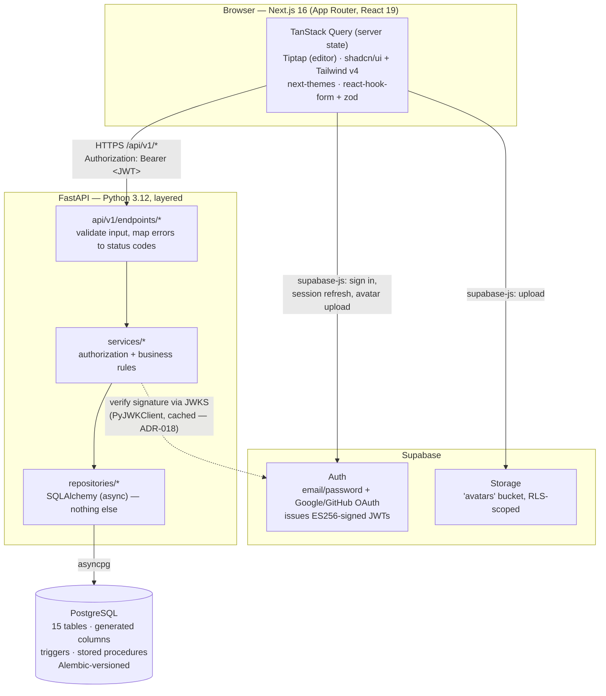
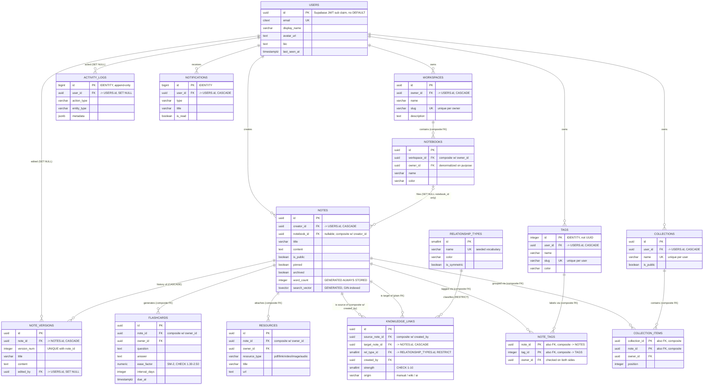
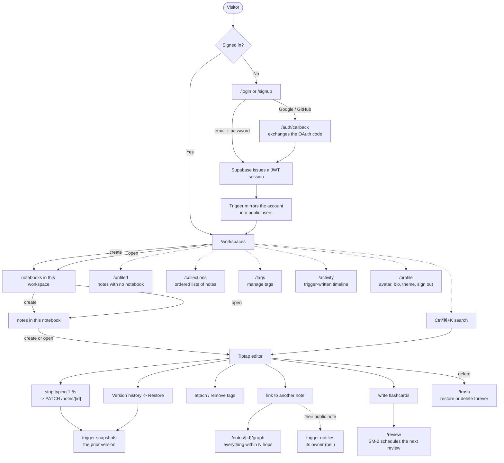

# NeuroVault

A personal knowledge base whose defining idea is that **notes form a graph**, not just a
tree of folders. Most note apps give you folders and tags — a hierarchy and a set.
NeuroVault's schema also models a third structure: an explicit, typed, directed edge
between any two notes, stored in a self-referencing many-to-many table that PostgreSQL
can traverse recursively.

Built as a DBMS course project. The point isn't a big feature list — it's a schema where
the database does real work: generated columns, a trigger-driven version history and
audit log, a tenancy model enforced by composite foreign keys rather than application
code, ranked full-text search on a GIN index, and a recursive-CTE knowledge graph.

## Contents

- [What's actually built](#whats-actually-built)
- [Architecture](#architecture)
- [Database schema](#database-schema)
- [User flow](#user-flow)
- [API reference](#api-reference)
- [Project structure](#project-structure)
- [Getting started](#getting-started)
- [Documentation](#documentation)

---

## What's actually built

This README describes the system as it exists, not as it was originally scoped — see
[Documentation](#documentation) below for the full design and its history.

**Live — has an API and a UI:**

| Area | What you can do |
|---|---|
| Auth | Sign up / sign in with email+password, or Google / GitHub OAuth. Sessions are Supabase-issued JWTs, verified by the backend via JWKS (no shared secret — [ADR-018](docs/adr/0018-jwt-verification-via-jwks.md)). |
| Profile | Display name, bio, avatar upload (Supabase Storage), sign out. |
| Workspaces & notebooks | Create, rename, color-code, delete. Deleting a workspace cascades; deleting a notebook un-files its notes instead of deleting them. |
| Notes | Rich-text editing (Tiptap: headings, bold/italic/underline/strike, highlight, lists, task lists, quotes, code, links), autosave 1.5s after you stop typing, pin, public/private toggle. |
| Unfiled notes | A dedicated view for notes with no notebook — including any left behind by a notebook delete. |
| Version history | Every real edit is versioned automatically by a database trigger, not application code. Restore any version from the UI; restoring is itself versioned, so you can always undo an undo. |
| Tags | Create, color-code, attach to and remove from notes. |
| Knowledge graph | Typed, directed links between notes (*supports*, *contradicts*, *prerequisite for*, …), including to other people's public notes. A graph view of everything within N hops, computed by a recursive CTE with a cycle guard and a depth limit. You can only originate a link from a note you own ([ADR-007](docs/adr/0007-links-originate-from-owned-notes.md)). |
| Search | Ctrl/⌘+K across your notes and public ones: `websearch_to_tsquery` syntax (`"exact phrase"`, `-exclude`, `or`), ranked by `ts_rank_cd`, matches highlighted in title and snippet. Served by a GIN index on the generated `search_vector`. |
| Trash | Deleting a note moves it to Trash; restore it, or delete it forever (only from Trash), which cascades to its versions, links, tags, cards and collection memberships. |
| Collections | Hand-picked, ordered lists of notes from any notebook — a note can be in many. Reorder with one `UPDATE … FROM unnest(…) WITH ORDINALITY`. |
| Flashcards & review | Question/answer cards on your notes, scheduled with the SM-2 spaced-repetition algorithm in exact `NUMERIC` arithmetic; the table's `CHECK`s encode the algorithm's own bounds. A keyboard-first review screen and a due-count badge. |
| Activity | A day-grouped timeline of what happened to your notes and links, written entirely by database triggers. Autosave bursts are merged into one entry by a gaps-and-islands window query. |
| Notifications | A bell with an unread count: a trigger notifies you when someone links to one of your public notes. |
| Theme | Light / dark / system, persisted. |

**Modeled and migrated, not yet exposed:**

| Area | What exists |
|---|---|
| Resources | Attachments (PDF/link/video/image/audio) — metadata only; the file itself would go straight to object storage. |

---

## Architecture



**Why the frontend talks to Supabase directly for identity but to FastAPI for
everything else:** Supabase Auth owns password hashing, OAuth redirects, and token
refresh — all easy to get subtly wrong by hand. FastAPI owns the domain: authorization
rules, the layered Route → Service → Repository structure, and the recursive graph and
full-text queries. The JWT is the handoff between the two: FastAPI never sees a password, and
Supabase never sees a note.

There are deliberately no `/auth/login` or `/auth/signup` routes on the backend. A new
Supabase account is synced into the app's own `users` table by a Postgres trigger
(`AFTER INSERT ON auth.users`, [ADR-017](docs/adr/0017-auth-users-trigger-not-webhook.md)),
not a webhook and not a lazy first-request check — both were tried and replaced.

### Tech stack

| Layer | Choice |
|---|---|
| Frontend | Next.js 16 (App Router), React 19, TypeScript, Tailwind CSS v4 |
| UI components | shadcn/ui + Radix primitives, Tiptap v3 (editor), lucide icons |
| Frontend state | TanStack Query for all server state; local `useState` for UI-only state — no global store |
| Backend | FastAPI, Python 3.12, Pydantic v2, `uv` for packaging |
| Database access | SQLAlchemy 2.0 (async) + `asyncpg`, Alembic migrations |
| Auth | Supabase Auth, verified backend-side via JWKS / ES256 (`PyJWKClient`) |
| Database | PostgreSQL — a Supabase project in this build ([ADR-012](docs/adr/0012-local-postgres-dev-supabase-prod.md), [ADR-014](docs/adr/0014-direct-supabase-dev-solo.md)); `docker-compose.yml` provisions an equivalent local Postgres 16 for an offline dev path |

---

## Database schema

All 15 tables, as actually migrated. `PK` = primary key, `FK` = foreign key, `UK` = unique
constraint. Every relationship into `notes`, `notebooks`, `note_tags`, and
`collection_items` is enforced by a **composite foreign key** that carries an owner or
creator column alongside the "real" reference — cross-tenant writes aren't caught by
application code, they're rows PostgreSQL physically refuses to store
([ADR-001](docs/adr/0001-tenancy-composite-foreign-keys.md)).



**The two `NOTES ||--o{ KNOWLEDGE_LINKS` lines together are the whole graph design.**
`knowledge_links` is a self-referencing many-to-many junction on `notes` — two foreign
keys, both ultimately pointing back at the same table, deliberately asymmetric: the
source side is a composite FK requiring `created_by` (you can only originate an edge from
a note you own), the target side is a plain FK (you may point at any note you can read,
including someone else's public one).

**What Postgres does on its own**, live today, that no application code triggers:

- `notes.word_count` and `notes.search_vector` — `GENERATED ALWAYS ... STORED` columns,
  recomputed on every write.
- `fn_create_note_version()` — `BEFORE UPDATE ON notes`, snapshots the *prior* title and
  content into `note_versions` whenever either actually changed.
- `sp_rollback_note_version(...)` — a stored procedure that restores an old version via an
  ordinary `UPDATE`, so the rollback itself fires the versioning trigger too.
- `handle_new_auth_user()` — `AFTER INSERT ON auth.users`, mirrors a new Supabase account
  into `public.users`.
- `fn_log_note_activity()` / `fn_log_link_activity()` — `AFTER` triggers on `notes` and
  `knowledge_links` that write the append-only `activity_logs`, recording only meaningful
  changes (a pin toggle logs nothing). They skip rows whose user is already gone, so
  account deletion's cascade isn't blocked by the audit FK
  ([ADR-020](docs/adr/0020-audit-triggers-skip-deleted-users.md)).
- `fn_notify_on_link()` — `AFTER INSERT ON knowledge_links`, notifies the target note's
  owner when someone else links to it.

All three audit triggers are `SECURITY DEFINER`, so no client role needs `INSERT` on the
audit tables. Every column with a default has it on the database side, not just in the
ORM, so plain SQL and triggers get the same defaults the app does.

---

## User flow



Deleting a notebook doesn't delete its notes — they fall through to `/unfiled`, reachable
from the sidebar at any time, which is the only reason that page exists. Deleting a note
only moves it to Trash; nothing is gone until you delete it forever from there.

---

## API reference

All routes are under `/api/v1`, authenticated with `Authorization: Bearer <Supabase JWT>`.
Interactive docs (`/docs`) are available when running outside production.

| Resource | Method | Path | Notes |
|---|---|---|---|
| Users | `GET` | `/users/me` | current user's profile |
| | `PATCH` | `/users/me` | update display name / bio / avatar URL |
| Workspaces | `GET` | `/workspaces` | list your workspaces |
| | `POST` | `/workspaces` | create |
| | `GET` | `/workspaces/{id}` | |
| | `PATCH` | `/workspaces/{id}` | |
| | `DELETE` | `/workspaces/{id}` | cascades to its notebooks and notes |
| Notebooks | `GET` | `/notebooks?workspace_id=` | |
| | `POST` | `/notebooks` | |
| | `GET` | `/notebooks/{id}` | |
| | `PATCH` | `/notebooks/{id}` | |
| | `DELETE` | `/notebooks/{id}` | its notes become unfiled, not deleted |
| Notes | `GET` | `/notes?notebook_id=&unfiled=&archived=` | |
| | `GET` | `/notes/search?q=&limit=` | ranked, highlighted; your notes + public ones |
| | `POST` | `/notes` | |
| | `GET` | `/notes/{id}` | |
| | `PATCH` | `/notes/{id}` | a real title/content change is auto-versioned; `archived: false` restores from Trash |
| | `DELETE` | `/notes/{id}` | moves to Trash; does not hard-delete |
| | `DELETE` | `/notes/{id}/permanent` | only for a note already in Trash; cascades |
| Note versions | `GET` | `/notes/{id}/versions` | owner-only |
| | `POST` | `/notes/{id}/versions/{version_num}/rollback` | itself creates a new version |
| Note tags | `GET` | `/notes/{id}/tags` | |
| | `POST` | `/notes/{id}/tags/{tag_id}` | attach; idempotent |
| | `DELETE` | `/notes/{id}/tags/{tag_id}` | detach |
| Links | `GET` | `/notes/{id}/links` | incoming and outgoing |
| | `POST` | `/notes/{id}/links` | from a note you own, to any note you can read |
| | `DELETE` | `/notes/{id}/links/{link_id}` | |
| | `GET` | `/notes/{id}/graph?max_depth=` | recursive CTE, depth 1–6 |
| | `GET` | `/relationship-types` | the seeded link vocabulary |
| Tags | `GET` | `/tags` | |
| | `POST` | `/tags` | |
| | `PATCH` | `/tags/{id}` | |
| | `DELETE` | `/tags/{id}` | |
| Collections | `GET` | `/collections` | with item counts |
| | `POST` | `/collections` | 409 on a duplicate name |
| | `GET` | `/collections/{id}` | with ordered items |
| | `PATCH` | `/collections/{id}` | |
| | `DELETE` | `/collections/{id}` | the notes are untouched |
| | `POST` | `/collections/{id}/items` | add a note you own; idempotent |
| | `DELETE` | `/collections/{id}/items/{note_id}` | |
| | `PUT` | `/collections/{id}/items/order` | the full member list, in the new order |
| Flashcards | `GET` | `/flashcards?note_id=` | cards on one note |
| | `GET` | `/flashcards/due?limit=` | most overdue first |
| | `GET` | `/flashcards/summary` | total, due, next due |
| | `POST` | `/flashcards` | |
| | `PATCH` | `/flashcards/{id}` | rewording keeps the schedule |
| | `DELETE` | `/flashcards/{id}` | |
| | `POST` | `/flashcards/{id}/review` | `quality` 0–5; runs SM-2 |
| Activity | `GET` | `/activity?limit=` | consecutive identical events merged |
| Notifications | `GET` | `/notifications` | recent, read and unread |
| | `GET` | `/notifications/unread-count` | the bell badge |
| | `POST` | `/notifications/{id}/read` | |
| | `POST` | `/notifications/read-all` | |

---

## Project structure

```
Neuro_Vault/
├── backend/                 FastAPI, Python 3.12, uv
│   ├── app/
│   │   ├── api/v1/endpoints/    routes — validate input, call a service, return a status
│   │   ├── services/            authorization + business rules, no SQLAlchemy
│   │   ├── repositories/        SQLAlchemy queries, nothing else
│   │   ├── models/               ORM models — the 15-table schema
│   │   ├── schemas/              Pydantic request/response shapes
│   │   ├── core/                 config, JWT verification, exceptions
│   │   └── tests/                pytest, against a real PostgreSQL — triggers and constraints included
│   ├── ci/                       stubs for Supabase's auth/storage schemas, so CI can migrate a plain Postgres
│   └── alembic/versions/        every schema/trigger/procedure change, versioned
├── frontend/                Next.js 16, React 19, TypeScript
│   └── src/
│       ├── app/                  App Router pages
│       ├── components/           editor, layout, notes, search, notifications, ui (shadcn)
│       └── hooks/                TanStack Query hooks, one per resource
├── .github/workflows/ci.yml  lint, type-check, tests (backend) and lint, type-check, build (frontend) on every PR
├── docs/
│   ├── adr/                      Architecture Decision Records, one per decision
│   ├── phases/New/               the full original design (architecture, schema, API, viva prep)
│   └── session-log-2026-08-16.md build diary: what broke, why, and how it was fixed
└── docker-compose.yml        local Postgres + migrate + backend, for an offline dev path
```

---

## Getting started

**Prerequisites:** Node 20+, [pnpm](https://pnpm.io), Python 3.12+,
[uv](https://docs.astral.sh/uv/), and a PostgreSQL database — either a
[Supabase](https://supabase.com) project (recommended; this is what the app is built and
tested against) or the local Postgres the included `docker-compose.yml` provisions.

1. **Configure environment variables.**
   ```
   cp .env.example .env
   cp frontend/.env.example frontend/.env.local
   ```
   Fill in your Supabase project's URL, anon key, and a Postgres connection string (root
   `.env`) — see the comments in each `.env.example` for what's sensitive and what isn't.

2. **Run the database migrations.**
   ```
   cd backend
   uv sync
   uv run alembic upgrade head
   ```

3. **Start the backend.**
   ```
   uv run uvicorn app.main:app --reload
   ```
   API at `http://localhost:8000`, interactive docs at `http://localhost:8000/docs`.

4. **Start the frontend**, in a separate terminal:
   ```
   cd frontend
   pnpm install
   pnpm dev
   ```
   App at `http://localhost:3000`.

**Alternative:** `docker compose up` provisions a local Postgres, runs migrations, and
starts the backend in one step (still start the frontend separately with `pnpm dev`).

**Running the tests.** The backend suite runs against a real database, because most of
what it checks lives there: triggers, generated columns, `CHECK` and composite-FK
constraints, and `EXPLAIN` checks that the queries really use their indexes. Each test
runs in a transaction that is always rolled back, so it's safe against your dev database.
```
cd backend
uv run pytest
```
CI runs the same suite against a fresh `postgres:16` on every pull request, with
`backend/ci/bootstrap_supabase_stubs.sql` standing in for Supabase's `auth` and `storage`
schemas.

---

## Documentation

- **[`docs/adr/`](docs/adr/)** — Architecture Decision Records. Each one records a
  problem, the alternatives considered, what was chosen, and the trade-off — the answers
  to "why did you do it that way?"
- **[`docs/phases/New/`](docs/phases/New/)** — the full original design: architecture,
  schema rationale, the SQL layer (triggers/views/procedures), API contract, frontend
  plan, and a schema/ER/user-flow diagram set.
- **[`docs/session-log-2026-08-16.md`](docs/session-log-2026-08-16.md)** — a build diary:
  what got built, what broke, how each bug was actually diagnosed and fixed.

## License

[Apache 2.0](LICENSE)
