# NeuroVault: Project Overview

> A knowledge base where notes form a graph, and PostgreSQL does the heavy lifting.

This document explains the whole project in one place: what it does, how it is built,
how the database is designed, and how the parts talk to each other. It is written to be
read top to bottom, and to be turned into a presentation; [section 15](#15-presentation-outline)
gives a slide-by-slide outline with speaker notes.

All diagrams are [Mermaid](https://mermaid.js.org); GitHub renders them in place. To put
one on a slide, paste it into [mermaid.live](https://mermaid.live) and export PNG or SVG.

## Contents

1. [At a glance](#1-at-a-glance)
2. [The problem and the idea](#2-the-problem-and-the-idea)
3. [Features](#3-features)
4. [System architecture](#4-system-architecture)
5. [Technology stack](#5-technology-stack)
6. [Database design](#6-database-design)
7. [UML diagrams](#7-uml-diagrams)
8. [User flows](#8-user-flows)
9. [API](#9-api)
10. [Security](#10-security)
11. [Testing and quality](#11-testing-and-quality)
12. [Deployment](#12-deployment)
13. [Key design decisions](#13-key-design-decisions)
14. [Challenges, limitations and future work](#14-challenges-limitations-and-future-work)
15. [Presentation outline](#15-presentation-outline)
16. [Viva questions](#16-viva-questions)
17. [Glossary](#17-glossary)

---

## 1. At a glance

| | |
|---|---|
| **What** | A personal knowledge base. You write notes and connect them with typed, directed links; the app shows the resulting graph, finds paths between ideas, and turns notes into spaced-repetition flashcards. |
| **Why it is a DBMS project** | The database enforces and computes, not just stores: tenancy enforced by composite foreign keys, version history and audit log written by triggers, ranked full-text search on a GIN index, graph traversal as a database function, row level security as the last line of defence. |
| **Stack** | PostgreSQL (Supabase) · FastAPI (Python 3.12, async SQLAlchemy) · Next.js 16 / React 19 · Supabase Auth |
| **Size** | 15 tables · 12 migrations · 4 views · 3 graph functions · 1 stored procedure · 5 triggers · 60 API endpoints |
| **Quality** | 176 backend tests against a real PostgreSQL database · 33 browser tests with WCAG 2.1 AA accessibility scans · CI on every pull request |
| **Decisions** | 26 Architecture Decision Records (ADRs) in [`docs/adr/`](adr/) |
| **Interface** | A token-based design system with light and dark themes, a shared motion system that respects reduced motion, and accessibility checks on every pull request ([design-system.md](design-system.md)) |

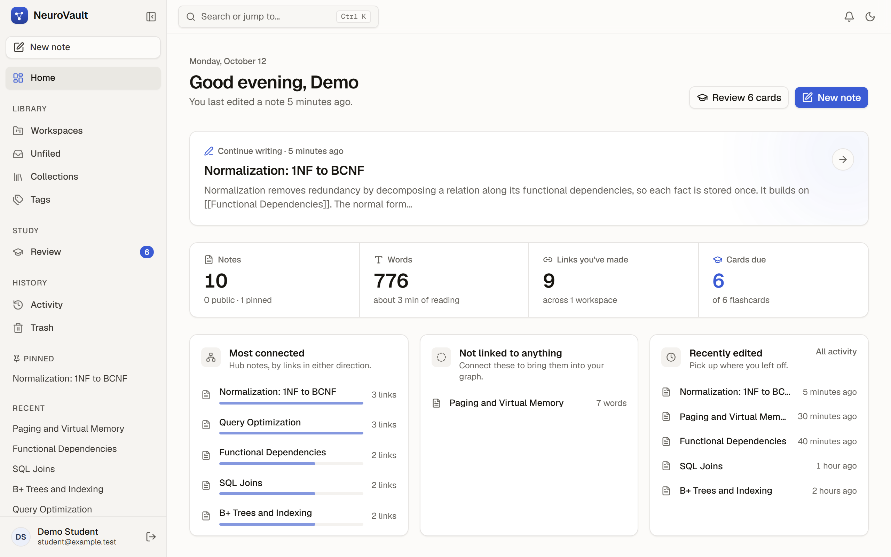

---

## 2. The problem and the idea

**The problem.** Most note apps give you two ways to organise knowledge:

- **Folders**, a hierarchy: each note lives in exactly one place.
- **Tags**, a set: a note can carry many labels, but the labels say nothing about how two
  notes relate.

Real understanding is neither. "Functional dependencies" is a *prerequisite for*
"Normalization"; one paper *contradicts* another; an example *supports* a claim. That
structure is a **graph**, and folders and tags can't express it.

**The idea.** Add a third structure: **typed, directed links between notes**, stored in a
self-referencing table that the database itself can traverse. With it you can ask questions
folders and tags can't answer:

- What is within two hops of this note?
- What is the shortest chain of ideas from A to B?
- Which notes are hubs, and which are connected to nothing?

**The design goal.** Because this is a database course project, push every rule the data
must obey into PostgreSQL, so it holds for every client: the API, the browser, a SQL
console, a future mobile app.

---

## 3. Features

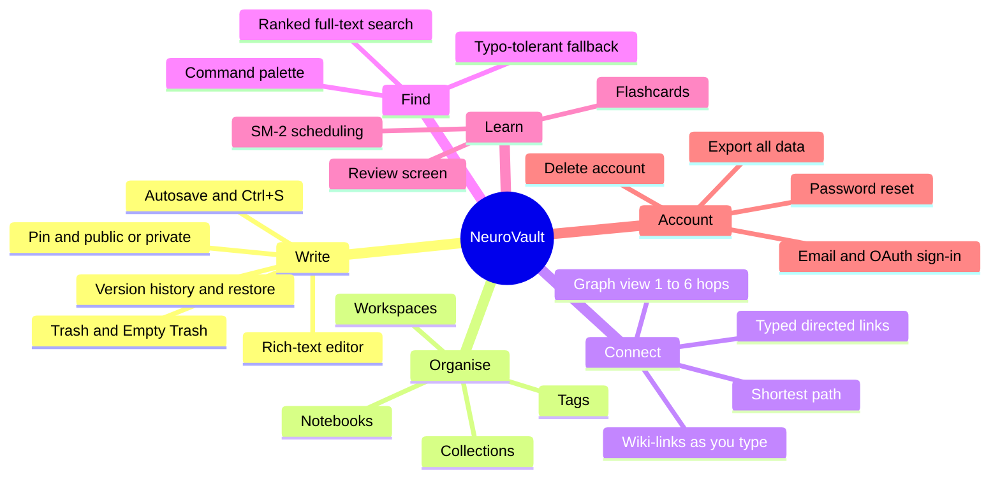

| Module | What the user can do | What the database does |
|---|---|---|
| **Notes** | Write rich text with autosave; pin; make public; move to Trash; restore | `word_count` and `search_vector` are generated columns; a `BEFORE UPDATE` trigger writes a version row for every real edit |
| **Version history** | Browse earlier versions, restore one in a click | `sp_rollback_note_version` restores through an ordinary `UPDATE`, so the restore is itself versioned (undo an undo) |
| **Organise** | Workspaces → notebooks → notes; tags; hand-ordered collections across notebooks | Composite foreign keys make it impossible to file a note in someone else's notebook |
| **Links** | Link notes with a type (supports, contradicts, prerequisite for …) and a strength 1–10 | `CHECK (strength BETWEEN 1 AND 10)`; the source must be your note, the target any note you can read |
| **`[[Wiki-links]]`** | Type `[[` to pick a note mid-sentence; Ctrl+click to open it, or create it if it doesn't exist | On save, links with `origin = 'wiki'` are reconciled with the text in one `DELETE` + one `INSERT … SELECT`; hand-made links are never touched |
| **Graph** | See every note within 1–6 hops; find the shortest path between two notes | `fn_note_distances` (breadth-first search in PL/pgSQL), `fn_shortest_path`, `fn_max_graph_depth` |
| **Search** | Ctrl+K command palette: search with phrases and `-exclusions`, highlighted results, typo fallback; jump to any page; create a note | GIN index on `tsvector`, `websearch_to_tsquery`, `ts_rank_cd`, `ts_headline`; trigram (`pg_trgm`) index on titles for typos |
| **Flashcards** | Add cards to any note; review due cards with four buttons | SM-2: `ease_factor NUMERIC(4,2) CHECK (1.30–2.50)`; `(owner_id, due_at)` index for the due queue |
| **Dashboard** | Totals, hub notes, unlinked notes, recent edits | `v_user_dashboard`, `v_note_graph_stats`, `v_orphan_notes` |
| **Activity and notifications** | Timeline of changes; a bell when someone links to your public note | `AFTER` triggers on notes and links write `activity_logs` and `notifications`; a window-function query collapses autosave bursts |
| **Interface** | Collapsible sidebar (`Ctrl \`) with Pinned and Recent notes; a home page that opens on "Continue writing"; palette that opens on recent notes; sans or serif writing font; animated light/dark theme switch; entrance, hover and loading motion that stops for reduced-motion users | Nothing: this is the front end's job. See [design-system.md](design-system.md) |
| **Account** | Email/password or Google/GitHub; password reset; export everything as JSON; delete the account | Export is one SQL statement of `jsonb_agg`; delete removes app data (cascading) and the login in one transaction |

---

## 4. System architecture

### 4.1 Context

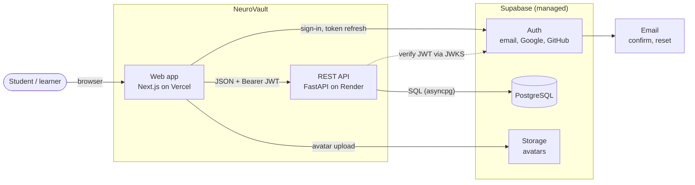

### 4.2 Containers and responsibilities

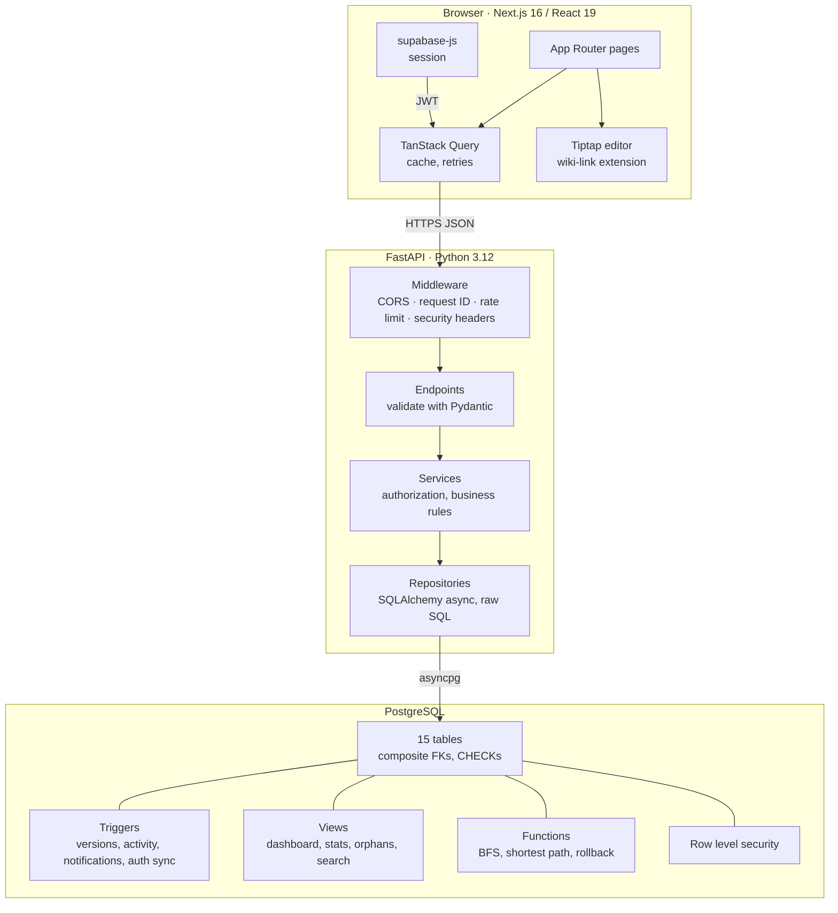

**Supabase owns identity; FastAPI owns the domain.** Password hashing, OAuth and token
refresh stay with Supabase Auth. Every domain query goes through FastAPI's three layers.
The JWT is the only handoff: FastAPI never sees a password, and Supabase never sees a note.

**Two enforcement points.**
1. Requests through FastAPI are authorized by the service layer.
2. Anything that reaches the database directly with the browser's public anon key is
   limited by row level security.

### 4.3 Backend layers

| Layer | Folder | Does | Never does |
|---|---|---|---|
| Middleware | `app/core/middleware.py` | Request ID, JSON access log, rate limit, security headers, JSON 500 | Business logic |
| Endpoints | `app/api/v1/endpoints/` | Parse and validate input (Pydantic), call one service, shape the response | SQL |
| Services | `app/services/` | Authorization ("is this your note?"), rules (wiki-link sync, SM-2), transactions | HTTP details |
| Repositories | `app/repositories/` | SQL and SQLAlchemy only | Decide who may do what |
| Database | `alembic/versions/` | Constraints, triggers, views, functions, policies | Trust the caller |

### 4.4 Frontend structure

| Folder | Contents |
|---|---|
| `src/app/(marketing)` | Public landing page |
| `src/app/(auth)` | Sign in, sign up, forgot and reset password, OAuth callback |
| `src/app/(app)` | Signed-in pages: dashboard, workspaces, notebooks, notes, graph, tags, collections, review, activity, trash, profile |
| `src/components` | Editor (Tiptap + wiki-links), graph canvas, command palette, layout (collapsible sidebar), account cards, motion helpers, landing-page previews, shadcn/ui primitives |
| `src/app/(app)/template.tsx` | Eases each page in on navigation, while the sidebar and header stay still |
| `src/hooks` | One TanStack Query module per resource (`use-notes`, `use-links`, …) |
| `src/app/globals.css` | Design tokens: colour, radius, elevation, light and dark themes |
| `e2e/` | Playwright browser tests with an in-memory fake backend |

---

## 5. Technology stack

| Layer | Technology | Why this one |
|---|---|---|
| Database | **PostgreSQL 15+** (Supabase in production, Postgres 16 in CI) | Recursive queries, PL/pgSQL, GIN and trigram indexes, generated columns, row level security, all in one engine. A graph database was considered and rejected ([ADR-011](adr/0011-postgresql-not-graph-database.md)) |
| Migrations | **Alembic** | Every table, index, view, function, trigger and policy is versioned, with a working `downgrade` |
| Backend | **FastAPI**, Pydantic v2 | Async, typed request/response models, automatic OpenAPI docs |
| Data access | **SQLAlchemy 2 (async) + asyncpg** | ORM for simple CRUD, raw SQL where PostgreSQL features matter |
| Auth | **Supabase Auth** | Email + OAuth + reset emails handled; JWTs verified in the backend via JWKS (ES256) |
| Frontend | **Next.js 16** (App Router), React 19, TypeScript | Routing, production builds, security headers |
| UI | Tailwind CSS v4, shadcn/ui, lucide icons | Accessible primitives and a token-based design system ([design-system.md](design-system.md)) |
| Motion | **motion** (the Framer Motion successor) plus CSS keyframes | Layout animations (the sliding sidebar pill), staggered entrances, drawing graph links; all stop under reduced motion |
| Type | Geist Sans and Mono; Newsreader as an optional writing font | A modern interface face, with a serif for long-form reading |
| Editor | **Tiptap 3** (ProseMirror) | Rich text, custom extensions (the wiki-link decorations and autocomplete) |
| Server state | **TanStack Query** | Caching, background refetch, optimistic updates |
| Tests | pytest, Playwright, axe-core | Backend against a real database; browser tests with accessibility scans |
| Tooling | uv, pnpm, ruff, pyright, ESLint, Prettier | Fast installs, lint and type checks |
| CI/CD | GitHub Actions, Docker, Render, Vercel | Every pull request runs both suites; production image is non-root |

---

## 6. Database design

### 6.1 Entity-relationship diagram

15 tables. Every relationship into `notes`, `notebooks`, `note_tags` and
`collection_items` is a **composite foreign key that carries the owner**, so a row can only
point at rows the same user owns.

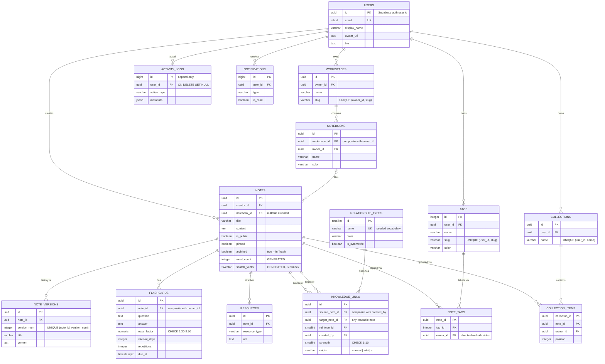

**The graph is the two `NOTES → KNOWLEDGE_LINKS` relationships**: a self-referencing
many-to-many on `notes`. It is deliberately asymmetric: the source side requires that you
own the note, the target side lets you point at any note you can read, including other
people's public notes ([ADR-007](adr/0007-links-originate-from-owned-notes.md)).

### 6.2 Table dictionary

| Table | Purpose | Notable constraints |
|---|---|---|
| `users` | Mirror of the Supabase login, created by a trigger on `auth.users` | `email citext UNIQUE` (case-insensitive) |
| `workspaces` | Top-level container | `UNIQUE (owner_id, slug)` |
| `notebooks` | Folder inside a workspace | `(workspace_id, owner_id) → workspaces(id, owner_id)` |
| `notes` | The core entity | Generated `word_count`, `search_vector`; `(notebook_id, creator_id) → notebooks(id, owner_id)` |
| `note_versions` | Every earlier title and content | `UNIQUE (note_id, version_num)`; written only by the trigger |
| `relationship_types` | Link vocabulary: relates_to, supports, contradicts, extends, example_of, prerequisite_for, see_also | Seeded by a migration |
| `knowledge_links` | Directed, typed edges between notes | `CHECK strength 1–10`, `CHECK origin IN ('manual','wiki','ai')`, `CHECK source <> target` (no self-links), `UNIQUE (source, target, type)` |
| `tags`, `note_tags` | Labels and their many-to-many with notes | Owner checked on both sides of the junction |
| `collections`, `collection_items` | Ordered, hand-picked note lists | `position` for ordering; owner on both sides |
| `flashcards` | Q/A cards with SM-2 state | `CHECK ease_factor 1.30–2.50` |
| `resources` | Attachments (schema only; no UI yet) | Composite owner FK |
| `activity_logs` | Append-only audit trail | `user_id ON DELETE SET NULL` keeps history readable |
| `notifications` | "Someone linked to your note" | Partial index on unread |

### 6.3 Normalization

The schema is in **3NF**, and every table except where noted is in **BCNF**:

- **1NF:** every column is atomic. Tags are a separate table, not a comma list; versions
  are rows, not a JSON array.
- **2NF:** junction tables (`note_tags`, `collection_items`) have composite keys, and every
  non-key column depends on the whole key (`position` depends on both collection and note).
- **3NF / BCNF:** no non-key column determines another. Derived values (`word_count`,
  `search_vector`) are **generated columns**, so they can't drift from `content`.
- **Deliberate redundancy:** `owner_id` is repeated on child tables (`notebooks`,
  `note_tags`, `flashcards` …). This is not an anomaly: it is part of each composite
  foreign key, and it is what lets PostgreSQL refuse a cross-user row
  ([ADR-001](adr/0001-tenancy-composite-foreign-keys.md)). The composite FK guarantees the
  copy always agrees with its parent.

### 6.4 What the database computes and enforces

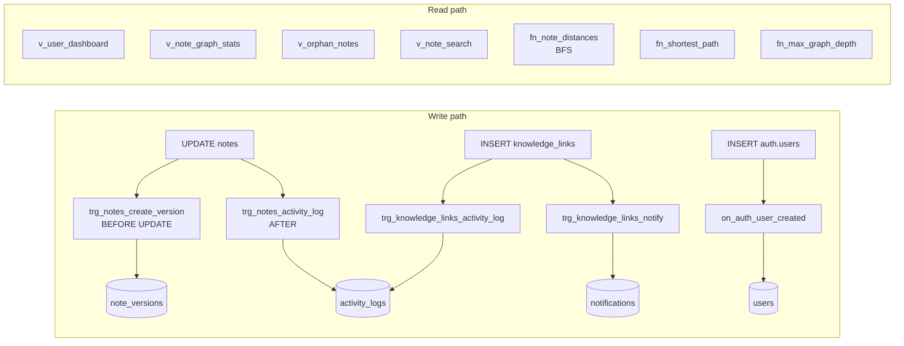

| Object | Kind | What it does |
|---|---|---|
| `fn_create_note_version` / `trg_notes_create_version` | Trigger (`BEFORE UPDATE`) | Saves the old title and content as the next version, only when they actually changed |
| `sp_rollback_note_version` | Stored procedure | Restores a version via a normal `UPDATE`, so the restore is versioned too |
| `fn_log_note_activity`, `fn_log_link_activity` | Triggers (`AFTER`) | Append to `activity_logs`; skip rows whose user is being deleted ([ADR-020](adr/0020-audit-triggers-skip-deleted-users.md)) |
| `fn_notify_on_link` | Trigger (`AFTER INSERT`) | Notifies a note's owner when someone else links to it |
| `handle_new_auth_user` | Trigger on `auth.users` | Creates the matching `public.users` row on sign-up ([ADR-017](adr/0017-auth-users-trigger-not-webhook.md)) |
| `fn_note_distances` | PL/pgSQL function | Breadth-first search: each note expanded once, unlike a naive recursive CTE that enumerates every path ([ADR-021](adr/0021-graph-traversal-is-breadth-first.md)) |
| `fn_shortest_path` | PL/pgSQL function | BFS with parent pointers; returns the route as ordered steps |
| `fn_max_graph_depth` | PL/pgSQL function | Distance to the farthest reachable note |
| `v_user_dashboard`, `v_note_graph_stats`, `v_orphan_notes`, `v_note_search` | Views | One definition per aggregate; `security_invoker` so RLS still applies ([ADR-022](adr/0022-views-are-security-invoker.md)) |

### 6.5 Indexes

Every index serves a named query and has an `EXPLAIN` test proving it is used.

| Index | Type | Serves |
|---|---|---|
| `idx_notes_search_vector` | GIN on `tsvector` | Full-text search |
| `idx_notes_title_trgm` | GIN trigram | Typo-tolerant title search |
| `idx_notes_creator_id_pinned_updated_at` | B-tree composite in `ORDER BY` order, partial `WHERE archived = false` | Note lists: pinned first, newest first; Trash kept out of the index |
| `idx_notes_notebook_id` | B-tree, partial `WHERE notebook_id IS NOT NULL` | Notes in a notebook |
| `idx_knowledge_links_target_note_id` | B-tree | Incoming links (outgoing use the unique key's prefix) |
| `idx_note_versions_note_id_version_num` | B-tree | Version history, newest first |
| `idx_flashcards_owner_id_due_at` | B-tree | The due-cards queue |
| `idx_activity_logs_user_id_id` | B-tree | Activity timeline |
| `idx_notifications_user_id_*` | B-tree, partial on unread | Bell badge and list |

### 6.6 Example queries worth showing

**Ranked full-text search** (simplified from the search repository):

```sql
SELECT id, title,
       ts_rank_cd(search_vector, q) AS rank,
       ts_headline('english', content, q) AS snippet
FROM notes, websearch_to_tsquery('english', :query) AS q
WHERE search_vector @@ q
  AND (creator_id = :me OR is_public)
  AND NOT archived
ORDER BY rank DESC
LIMIT 20;
```

**Wiki-link reconciliation** (on every save that changes content):

```sql
-- 1. Remove wiki links whose [[title]] is no longer in the text.
DELETE FROM knowledge_links
WHERE source_note_id = :note AND origin = 'wiki'
  AND target_note_id <> ALL(:resolved_ids);

-- 2. Add new ones, unless any link (hand-made or wiki) already exists.
INSERT INTO knowledge_links (source_note_id, target_note_id, rel_type_id, created_by, origin)
SELECT :note, t.id, :relates_to, :me, 'wiki'
FROM unnest(:resolved_ids) AS t(id)
WHERE NOT EXISTS (SELECT 1 FROM knowledge_links k
                  WHERE k.source_note_id = :note AND k.target_note_id = t.id)
ON CONFLICT DO NOTHING;
```

Titles are resolved with `SELECT DISTINCT ON (lower(title)) … ORDER BY lower(title),
updated_at DESC`, so a duplicate title links to the most recently edited note.

**Account export in one statement:**

```sql
SELECT jsonb_build_object(
  'user',      (SELECT to_jsonb(u) FROM users u WHERE id = :me),
  'notes',     (SELECT coalesce(jsonb_agg(n), '[]') FROM notes n WHERE creator_id = :me),
  'links',     (SELECT coalesce(jsonb_agg(l), '[]') FROM knowledge_links l WHERE created_by = :me),
  'flashcards',(SELECT coalesce(jsonb_agg(f), '[]') FROM flashcards f WHERE owner_id = :me)
  -- … one jsonb_agg per table
);
```

---

## 7. UML diagrams

### 7.1 Use case diagram

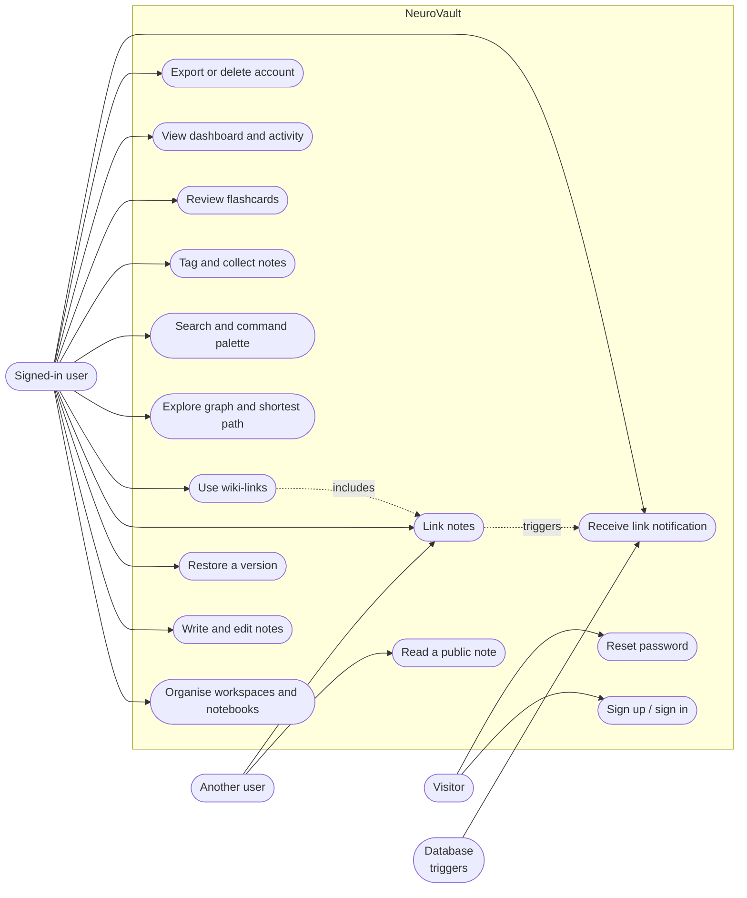

### 7.2 Class diagram (domain model)

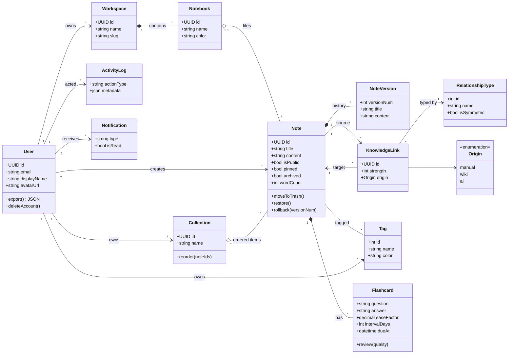

### 7.3 Sequence: signing in and calling the API

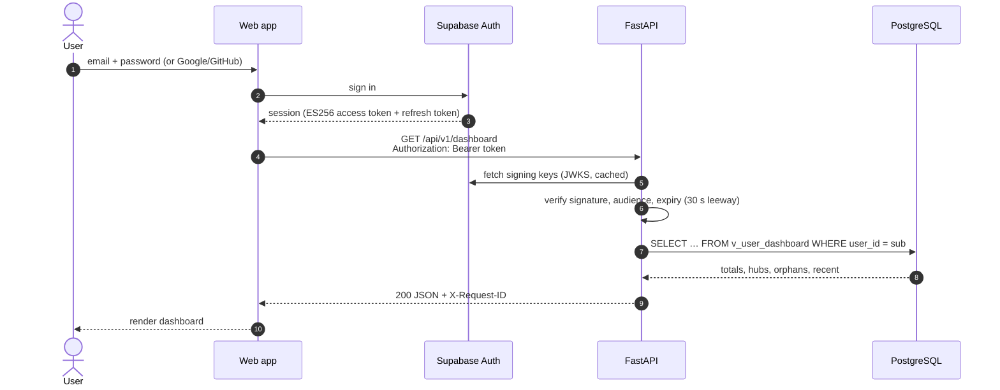

### 7.4 Sequence: saving a note (autosave, versioning, wiki-links)

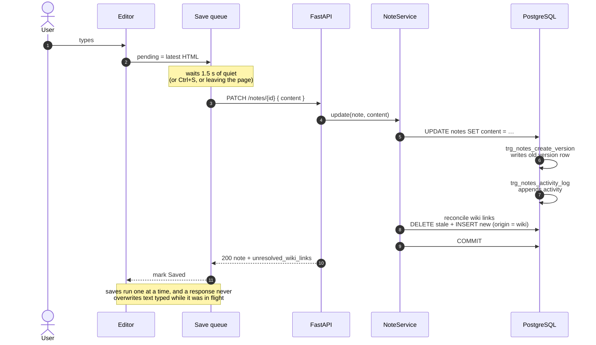

### 7.5 Sequence: linking to someone's public note

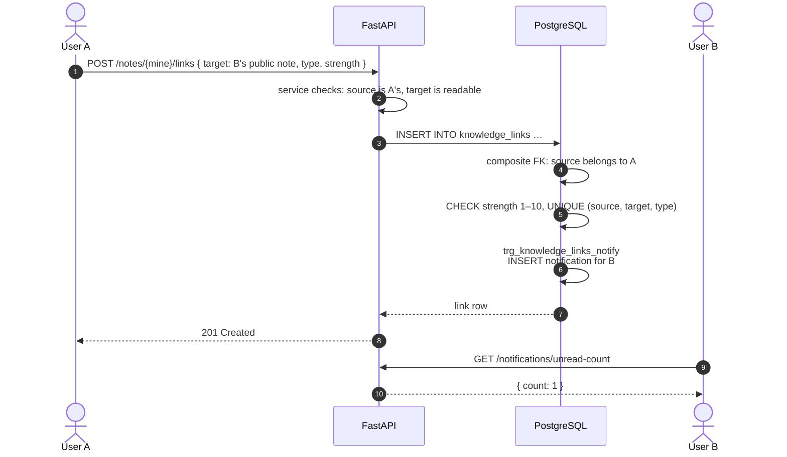

### 7.6 Sequence: shortest path between two notes

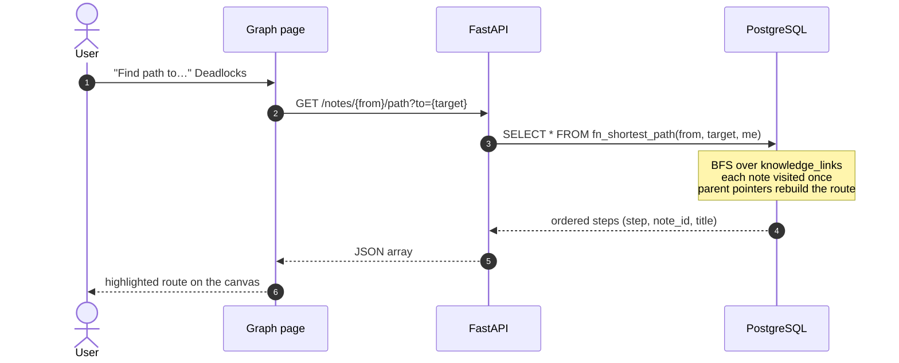

### 7.7 Sequence: reviewing a flashcard (SM-2)

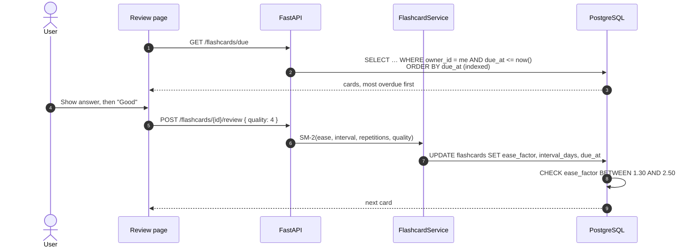

### 7.8 State diagram: a note's lifecycle

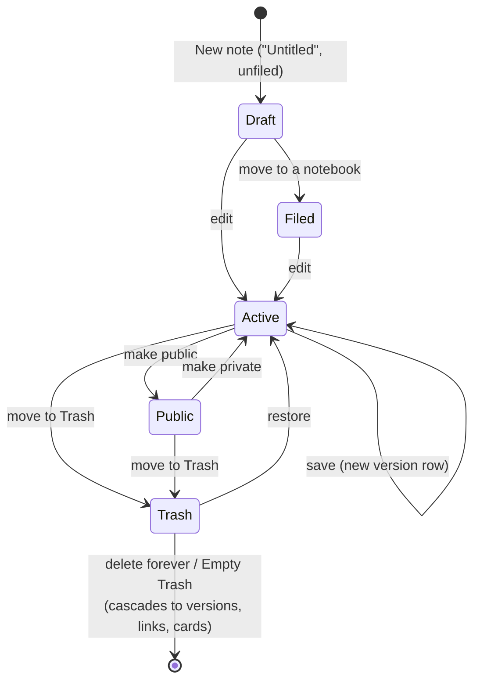

### 7.9 State diagram: the editor's save indicator

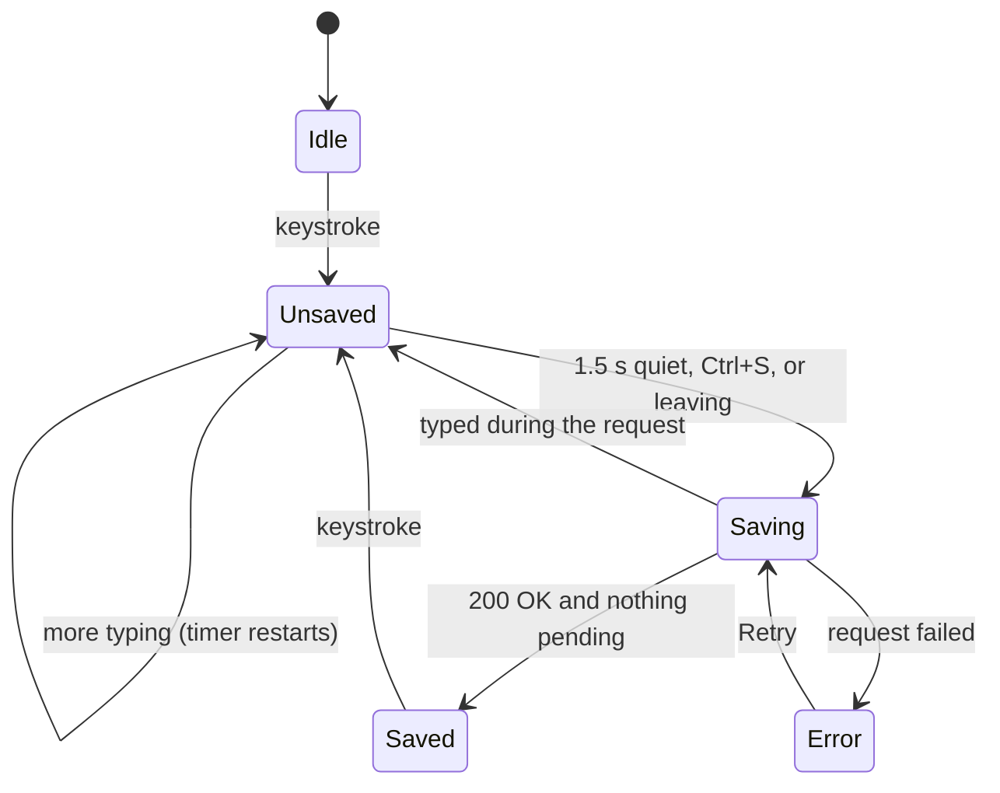

### 7.10 Activity diagram: wiki-link reconciliation

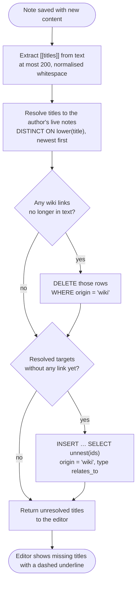

### 7.11 Deployment diagram

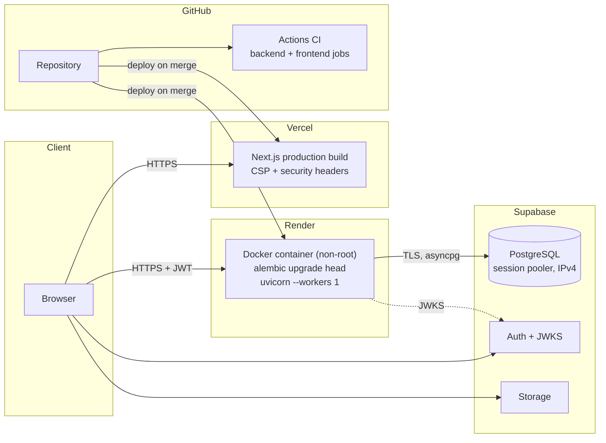

---

## 8. User flows

### 8.1 Overall navigation

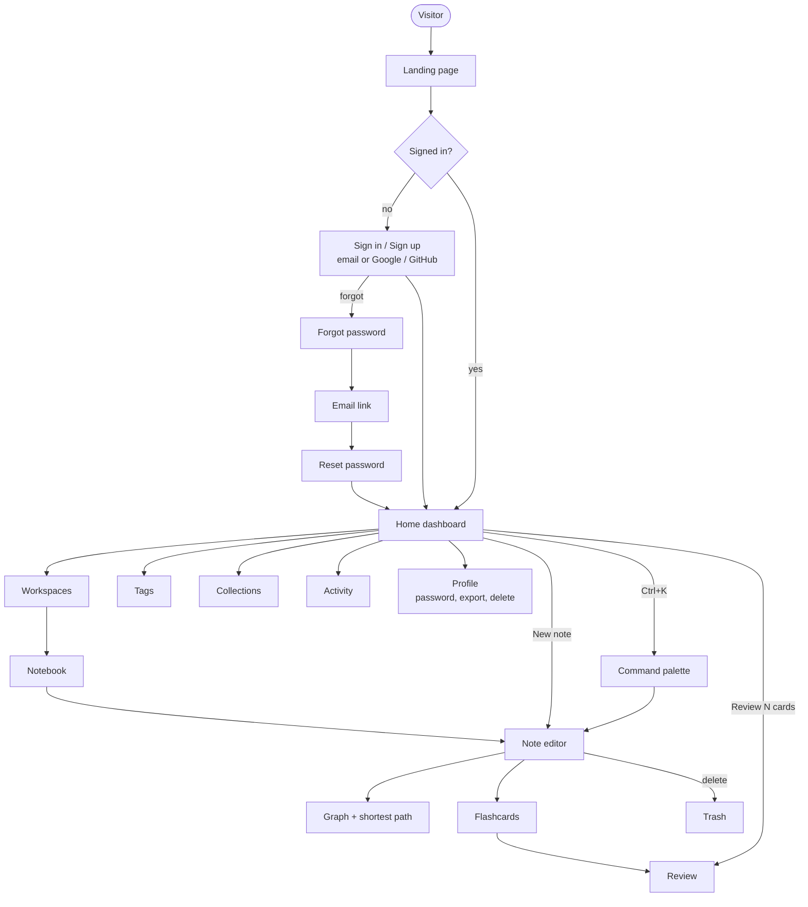

### 8.2 First-time user

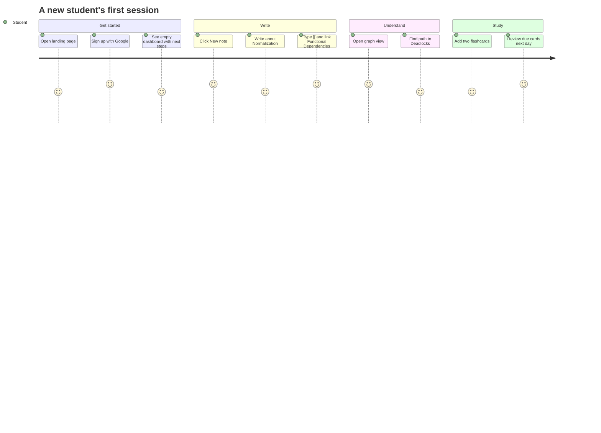

### 8.3 Writing and connecting a note

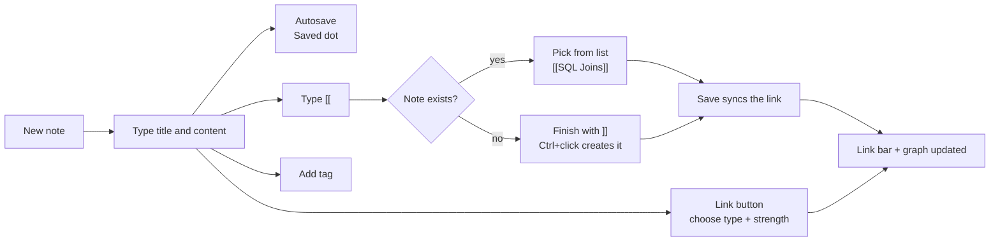

### 8.4 Studying

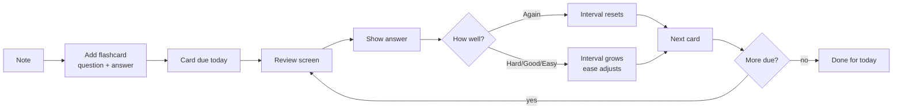

---

## 9. API

REST over JSON under `/api/v1`, 60 endpoints, authenticated with the Supabase access
token. Full list: [`api-reference.md`](api-reference.md).

| Area | Endpoints |
|---|---|
| Account | `GET/PATCH /users/me`, `GET /users/me/export`, `DELETE /users/me` |
| Dashboard | `GET /dashboard` |
| Workspaces, notebooks | CRUD on `/workspaces`, `/notebooks` |
| Notes | CRUD on `/notes`, `/notes/search`, `DELETE /notes/{id}/permanent`, `DELETE /notes/trash` |
| Versions | `GET /notes/{id}/versions`, `POST …/versions/{n}/rollback` |
| Tags | CRUD on `/tags`; attach and detach on `/notes/{id}/tags/{tag_id}` |
| Links and graph | `/notes/{id}/links`, `/graph?max_depth=`, `/path?to=`, `/stats`, `/relationship-types` |
| Collections | CRUD on `/collections`, items, `PUT …/items/order` |
| Flashcards | CRUD on `/flashcards`, `/flashcards/due`, `/flashcards/summary`, `POST …/review` |
| Activity, notifications | `/activity`, `/notifications`, `/unread-count`, read and read-all |

**Conventions:** errors are JSON `{"detail": …}`; every response carries `X-Request-ID`;
`404` (not `403`) for other people's private data, so existence doesn't leak; `429` with
`Retry-After` when rate-limited.

---

## 10. Security

Defence in depth: each layer assumes the one before it might fail.

```mermaid
flowchart TB
    R["Request"] --> L1["1. Rate limit per IP<br/>300/min, stricter on export, delete, Empty Trash"]
    L1 --> L2["2. JWT verification<br/>ES256 via JWKS, audience, expiry"]
    L2 --> L3["3. Service authorization<br/>owner checks, 404 for others' data"]
    L3 --> L4["4. Composite foreign keys<br/>cross-user rows can't be stored"]
    L4 --> L5["5. CHECK and UNIQUE constraints"]
    B["Browser with anon key"] --> L6["6. Row level security<br/>per-user policies on every table"]
```

| Concern | Measure |
|---|---|
| Passwords | Never touch the backend; Supabase Auth hashes and stores them |
| Tokens | ES256 signature verified against Supabase's public keys; algorithm pinned, not read from the token |
| Tenancy | Composite FKs + service checks + RLS |
| Abuse | Per-IP rate limiting with `429` and `Retry-After` ([ADR-024](adr/0024-in-process-rate-limiting.md)) |
| Browser attacks | Content Security Policy, `X-Frame-Options: DENY`, `nosniff`, strict referrer policy ([ADR-025](adr/0025-csp-without-nonces.md)) |
| Transport | HSTS in production |
| XSS in search | Highlights use sentinel characters, rendered as text, never as HTML |
| Errors | JSON 500 with a request ID, never a stack trace; `/docs` disabled in production |
| Container | Non-root user, no `.env` or dev dependencies in the image |
| Privacy | Export everything; delete the account and all data in one transaction |

---

## 11. Testing and quality

```mermaid
flowchart LR
    PR["Pull request"] --> CI{"GitHub Actions"}
    CI --> BE["Backend job"]
    CI --> FE["Frontend job"]
    BE --> B1["Fresh Postgres 16"] --> B2["Supabase stand-ins"] --> B3["alembic upgrade head"] --> B4["ruff + pyright"] --> B5["pytest (176)"]
    FE --> F1["ESLint + type-check"] --> F2["production build"] --> F3["Playwright + axe (33)"]
    B5 --> M{"All green?"}
    F3 --> M
    M -- yes --> Merge["Merge to main"]
```

| Suite | Count | What it proves |
|---|---|---|
| Backend (pytest) | 176 | Triggers, generated columns, CHECK and composite-FK constraints, RLS (by impersonating Supabase's REST role), `EXPLAIN` checks that queries use their indexes, wiki-link reconciliation, SM-2, account export and delete, middleware |
| Browser (Playwright) | 33 | Editor never loses edits, wiki-link autocomplete and Ctrl+click create, command palette, read-only public notes, Empty Trash, password reset, export download, delete confirmation, security headers |
| Accessibility (axe) | in the browser suite | WCAG 2.1 AA on the dashboard, a note, profile and shortcuts dialog, in light and dark themes |

**Every backend test runs inside a transaction that is rolled back**, so the suite is safe
to point at a development database. Two editor tests were written to fail on the old code
first, proving the data-loss bugs were real and are now fixed.

---

## 12. Deployment

| Piece | Where | How |
|---|---|---|
| Database + auth + storage | Supabase | Managed; migrations applied by the API container on start |
| API | Render | Production stage of `backend/Dockerfile`, described by `render.yaml`; `alembic upgrade head` then uvicorn |
| Web app | Vercel | Next.js production build with security headers |
| Local development | Docker Compose | Postgres 16 + migrations + backend; frontend with `pnpm dev` |

Step-by-step guide: [`deployment.md`](deployment.md).

---

## 13. Key design decisions

26 ADRs record the problem, the options, the choice, and why. The ones most worth
presenting:

| ADR | Decision | Why it matters |
|---|---|---|
| [001](adr/0001-tenancy-composite-foreign-keys.md) | Tenancy through composite foreign keys | The database refuses cross-user data instead of trusting the app |
| [002](adr/0002-generated-columns.md) | Generated columns for word count and search vector | Derived data can't drift |
| [003](adr/0003-sql-objects-in-migrations.md) | All SQL objects in migrations | Schema is reproducible and reviewable |
| [007](adr/0007-links-originate-from-owned-notes.md) | Links start from your notes, may target any readable note | Lets you build on others' public work without editing it |
| [008](adr/0008-row-level-security.md) / [023](adr/0023-rls-policies-as-built.md) | Row level security | Protects the one path that skips the API |
| [011](adr/0011-postgresql-not-graph-database.md) | PostgreSQL, not a graph database | One engine for relational data, search and traversal |
| [017](adr/0017-auth-users-trigger-not-webhook.md) | Sync users with a trigger, not a webhook | Atomic with sign-up, no network hop |
| [018](adr/0018-jwt-verification-via-jwks.md) | Verify JWTs via JWKS (ES256) | No shared secret in the backend |
| [021](adr/0021-graph-traversal-is-breadth-first.md) | Graph traversal is BFS, not a recursive CTE | Each note once, instead of every path |
| [022](adr/0022-views-are-security-invoker.md) | Views are `security_invoker` | Views can't bypass RLS |
| [024](adr/0024-in-process-rate-limiting.md) | In-process rate limiting | Simple, no extra infrastructure, one worker |
| [025](adr/0025-csp-without-nonces.md) | CSP without nonces | Keeps static rendering; documented trade-off |
| [026](adr/0026-design-tokens-and-restrained-motion.md) | Design tokens and restrained motion | Every screen looks like one product; the accessibility scan keeps it that way |

---

## 14. Challenges, limitations and future work

### Challenges solved

| Challenge | Solution |
|---|---|
| Typing right before leaving a note lost the last edit | Save queue flushes on unmount, page unload and Ctrl+S |
| A slow save's response overwrote text typed during it | Server content applied only when nothing is pending or in flight; saves serialised |
| Recursive CTE for "notes within N hops" exploded on dense graphs | PL/pgSQL BFS that expands each note once |
| "401 right after login" | Supabase's clock ran slightly ahead; 30 s JWT leeway |
| Wiki-links must never delete hand-made links | `origin` column; reconciliation only touches `origin = 'wiki'` |
| Audit triggers failed while deleting a user | Triggers skip rows whose user is being deleted (ADR-020) |
| Views silently bypassed RLS | `security_invoker = true` on every view |

### Known limitations

- **Attachments** (`resources`): table and policies exist; no upload API or UI yet.
- **Wiki-links resolve on save** of the note containing them; renaming the target later
  catches up on the source's next save.
- **Rate limits are per process**; the API runs one worker so limits stay correct.
- **Browser tests use a fake backend**; the real password-reset email round trip is tested
  by hand.

### Future work

- File attachments on Supabase Storage
- A whole-workspace graph view
- Real-time collaboration on shared notes
- AI-suggested links (the `origin = 'ai'` value is already in the schema)
- A mobile app on the same API

---

## 15. Presentation outline

A 15–20 minute talk, 14 slides. Each row: what goes on the slide, and what to say.

| # | Slide | Show | Say |
|---|---|---|---|
| 1 | **Title** | Name, logo, one-line tagline, team, course | "NeuroVault: a knowledge base where notes form a graph, and PostgreSQL does the heavy lifting." |
| 2 | **The problem** | Folders vs tags vs graph (three small pictures) | Folders and tags can't say *how* ideas relate. Real knowledge is a graph. |
| 3 | **The idea** | Typed links: Functional Dependencies → *prerequisite for* → Normalization | A third structure: typed, directed links the database can traverse. |
| 4 | **Demo: home + note** | `screenshots/dashboard.png`, `screenshots/note.png` | Walk through hub notes, unlinked notes, a note with tags, links and a `[[wiki-link]]`. |
| 5 | **Demo: graph + search + review** | `graph.png`, `search.png`, `review.png` | BFS in the database, shortest path highlighted, ranked search, SM-2 review. |
| 6 | **Architecture** | Diagram 4.1 or 4.2 | Supabase owns identity, FastAPI owns the domain, the JWT is the only handoff. |
| 7 | **Tech stack** | Table from section 5, as logos | Why PostgreSQL over a graph DB; why FastAPI; why Next.js. |
| 8 | **ER diagram** | Diagram 6.1 | 15 tables. The graph is a self-referencing many-to-many on notes. |
| 9 | **The database enforces** | Composite FK example, CHECKs, normalization (6.3) | Cross-user rows are impossible to store, not just forbidden. 3NF with one deliberate, safe redundancy. |
| 10 | **The database computes** | Diagram 6.4 + trigger/function table | Versions and audit by triggers; BFS and shortest path as functions; views for the dashboard. |
| 11 | **One feature end to end** | Sequence 7.4 (saving a note) or 7.10 (wiki-links) | Follow one keystroke to a version row and a reconciled link. |
| 12 | **Security** | Diagram from section 10 | Six layers; RLS protects the path that skips the API. |
| 13 | **Quality** | CI diagram from section 11, test counts | 176 database-backed tests, 33 browser tests, accessibility scans, CI on every PR, 26 ADRs. |
| 14 | **Learnings and future** | Challenges table + future work | What broke and how we fixed it; attachments, workspace graph, AI links. Q&A. |

**Live demo script (3 minutes):**
1. Sign in → home dashboard (point out hub notes and the unlinked note).
2. Click **New note**, type a sentence, type `[[` and pick *SQL Joins*; show *Saved*.
3. Open **View graph**, raise depth, **Find path to…** *Deadlocks*.
4. Press **Ctrl+K**, search `normal form`, show highlighted matches.
5. Open **Review**, show an answer, click *Good*.
6. Optional: open psql and show the new row in `note_versions` and `knowledge_links`
   with `origin = 'wiki'`.

---

## 16. Viva questions

| Question | Short answer |
|---|---|
| Why PostgreSQL and not Neo4j? | One engine covers relational data, full-text search, constraints, RLS and graph traversal at this scale; a second database would split transactions and double the operational work ([ADR-011](adr/0011-postgresql-not-graph-database.md)). |
| How do you stop one user writing into another's notebook? | Composite FK `(notebook_id, creator_id) → notebooks(id, owner_id)`: the row can't exist unless both belong to the same user. |
| Isn't repeating `owner_id` a normalization violation? | It is redundancy, but controlled: it is part of the foreign key, so the database guarantees it agrees with the parent. No update anomaly is possible. |
| How does version history work? | A `BEFORE UPDATE` trigger copies the old title and content into `note_versions` when they change. Restore goes through a procedure that does an ordinary `UPDATE`, so it is versioned too. |
| Why BFS instead of a recursive CTE? | A recursive CTE explores every path and can blow up on cycles and dense graphs; the BFS function marks visited notes and expands each one once. |
| How is search ranked? | `tsvector` generated column with a GIN index, `websearch_to_tsquery` for user syntax, `ts_rank_cd` for ranking, `ts_headline` for snippets, trigram similarity as a typo fallback. |
| What is RLS for if the API already checks ownership? | The browser holds a public anon key that can query Supabase directly. RLS is what stops that path. |
| Why are views `security_invoker`? | By default a view runs with its owner's rights and would bypass RLS; `security_invoker` runs it as the caller. |
| How do wiki-links avoid deleting manual links? | Each link records its `origin`; reconciliation deletes and inserts only `origin = 'wiki'` rows, and skips targets already linked by hand. |
| What does SM-2 store, and what does the DB enforce? | Ease factor, interval, repetitions, due date; `CHECK ease_factor BETWEEN 1.30 AND 2.50` keeps the algorithm in bounds. |
| How is account deletion safe? | One transaction deletes the app user (cascading to all data) and the Supabase login; either both happen or neither. |
| Which indexes did you add, and how do you know they're used? | Listed in section 6.5; each has a test that runs `EXPLAIN` and asserts the index appears in the plan. |

For hands-on SQL practice against the schema, see
[`viva-sql-practice.md`](viva-sql-practice.md); the full design rationale is in
[`phases/New/`](phases/New/).

---

## 17. Glossary

| Term | Meaning |
|---|---|
| **ADR** | Architecture Decision Record: a short document recording one decision and why |
| **BFS** | Breadth-first search: visits nodes in order of distance, each once |
| **Composite foreign key** | A foreign key over several columns, here `(id, owner)` |
| **GIN index** | Generalized Inverted Index: maps each word to the rows containing it |
| **Generated column** | A column computed by the database from other columns, always up to date |
| **JWKS** | JSON Web Key Set: the public keys used to verify a JWT's signature |
| **JWT** | JSON Web Token: the signed access token Supabase issues at sign-in |
| **RLS** | Row level security: per-row access policies enforced by PostgreSQL |
| **SM-2** | The SuperMemo-2 spaced repetition algorithm |
| **`security_invoker`** | A view option that runs the view with the caller's permissions |
| **Trigram** | Three-character substrings, used to find similar strings despite typos |
| **`tsvector` / `tsquery`** | PostgreSQL's full-text document and query types |
| **Wiki-link** | `[[Title]]` written in a note's text, turned into a real link on save |
