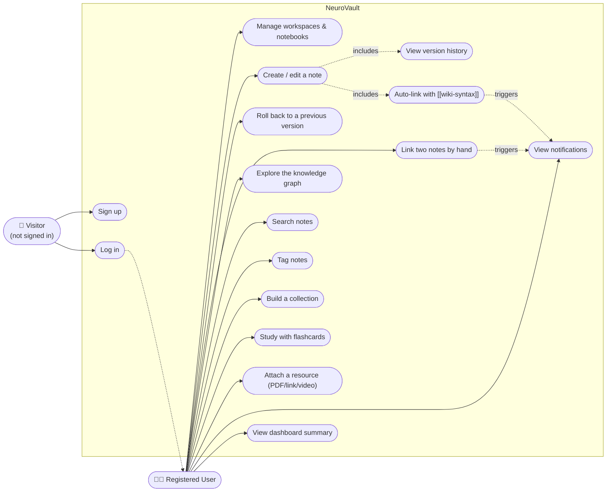
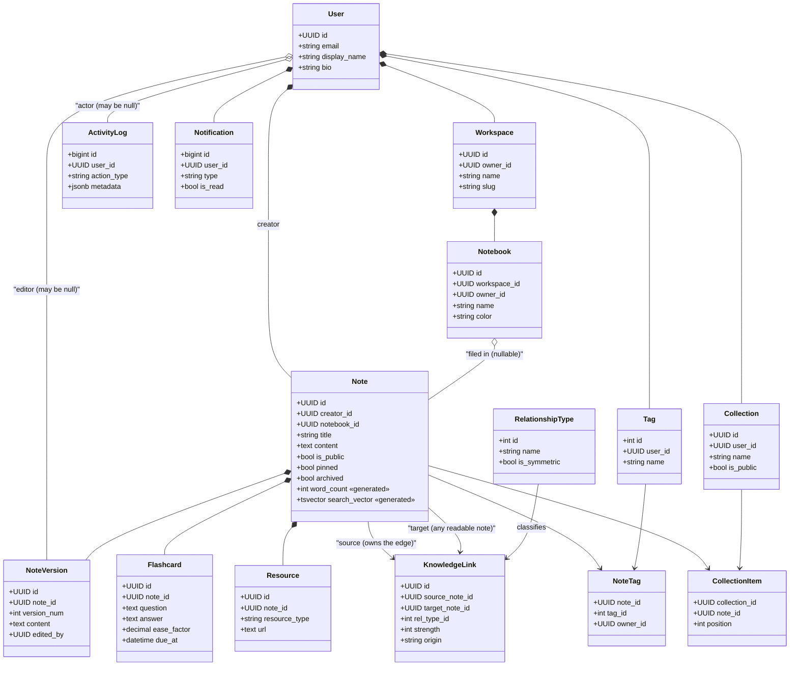
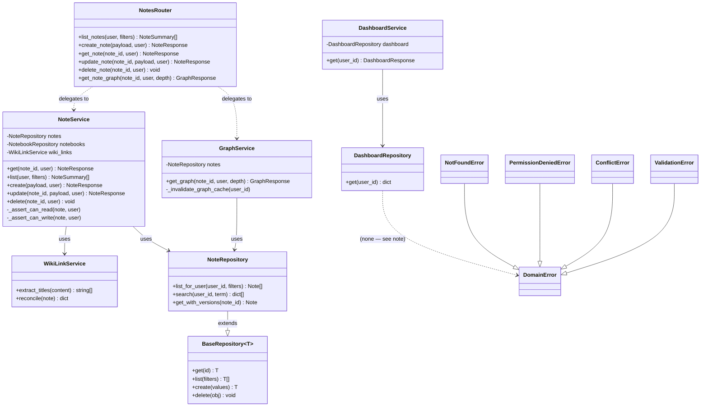
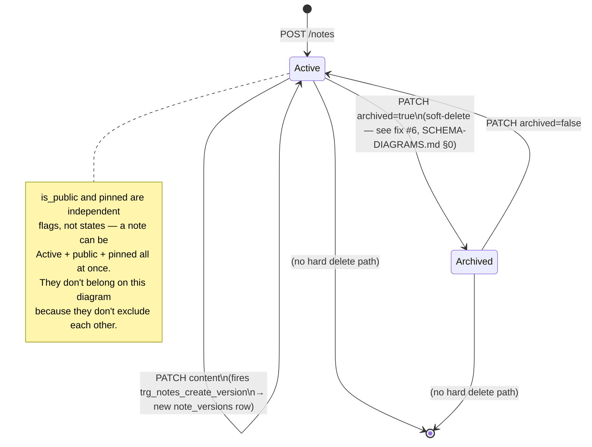

# NeuroVault — UML Diagrams, Functionalities &amp; DBMS Concept Map

> Companion to [`SCHEMA-DIAGRAMS.md`](SCHEMA-DIAGRAMS.md) (ER diagram, physical schema,
> sequence diagrams) and [`08-VIVA.md`](08-VIVA.md) (the same facts, organized by exam
> course outcome instead of by feature). This file answers three questions in plain
> language: **what does the system look like as UML**, **what can a user actually do**,
> and **for each thing a user can do, which database idea is doing the work underneath**.
>
> Diagrams are [Mermaid](https://mermaid.js.org) — they render on GitHub, in VS Code, and
> in the published Artifact version of this file.

---

## How to read this file

Every technical term is explained the first time it's used, and §4 is a plain-English
glossary you can jump to any time a word doesn't land. Each row in §3 (the main table)
is written as two layers: a **plain-language sentence** first, then a **"technically"**
line with the exact table/trigger/index name, so the same row works whether you're
explaining it to a friend or defending it to an examiner.

---

## 1. UML Diagrams

### 1.1 Use Case Diagram

Who can do what. NeuroVault has one actor — every screen sits behind login, and even a
"public" note still requires a valid session to fetch through the API (Row Level
Security and the backend both check the token; nothing is served to a signed-out
request). "Visitor" appears only for the two use cases that happen *before* that session
exists.



**Why "link two notes" and "auto-link" both point at "view notifications"**: linking to
someone else's public note fires a database trigger that creates a notification for
them — a single piece of backend behaviour that two different user actions share. That's
worth seeing on the use-case diagram, not just in the code.

### 1.2 Class Diagram — the domain model

The 15 tables, drawn as UML classes instead of database tables. The relationship arrows
are chosen to mean something specific, not decorative:

```
●— (filled diamond) = COMPOSITION  = the ON DELETE behaviour is CASCADE
                                      (the child cannot outlive the parent)
○— (hollow diamond) = AGGREGATION  = the ON DELETE behaviour is SET NULL
                                      (the child survives; it just loses the reference)
 → (plain arrow)     = ASSOCIATION = ON DELETE RESTRICT, or a row that is jointly
                                      owned by two parents (a link/junction row can't
                                      have a single "whole" in UML's sense)
```

That mapping isn't a simplification for the diagram — it's the literal rule UML uses to
distinguish composition from aggregation, and NeuroVault's foreign keys already encode it
exactly (`02-DATABASE.md` §2.4). Seeing it drawn out is a good way to *notice* it, if you
haven't already.



**One class deliberately looks like everyone else's relationship, but isn't**:
`KnowledgeLink` is connected to `Note` twice, with plain association arrows instead of
composition. That's not an oversight — a `knowledge_links` row is deleted if *either* the
source note or the target note is deleted (both foreign keys CASCADE), so it doesn't have
a single "owner" the way a `NoteVersion` belongs to exactly one `Note`. UML composition
means exclusive ownership; this relationship genuinely isn't that, so it isn't drawn that
way.

### 1.3 Class Diagram — the application layers

A second class diagram, deliberately not the same shape as the first. This one shows
*code*, not *data* — the Route → Service → Repository layering from
`00-ARCHITECTURE.md` §0.3, using the actual class and method names from `04-API.md`.
The two diagrams together are the standard UML pairing: a **domain model** (what the
data looks like) and an **architecture model** (what the software looks like).



**The rule this diagram makes visible**: `NotesRouter` never touches a repository
directly, and `NoteService` never imports anything from FastAPI. Every arrow points
*down* one layer, never sideways past it and never up. That's not a suggestion in the
code — `04-API.md` §4.11's checklist literally runs `grep -r "sqlalchemy" app/api/` and
expects zero matches, and this diagram is what that grep is protecting.

**The exception hierarchy is real UML inheritance**, not a stretch: `NotFoundError`,
`PermissionDeniedError`, `ConflictError`, and `ValidationError` all extend `DomainError`,
and `main.py` catches `DomainError` once and maps each subtype to an HTTP status code
(404 / 403 / 409 / 422). One `except` clause, four outcomes — that's the point of using
inheritance here instead of four separate handlers.

### 1.4 State Diagram — a note's lifecycle

Not every table needs a state diagram — most are just records. `notes` is the one table
where a row visibly moves between named states over its lifetime, so it's the one worth
drawing this way.



**Why "Archived" loops back to "Active" instead of being a dead end**: this is the fix
from `SCHEMA-DIAGRAMS.md` §0 item 6. The API's `DELETE` route only ever sets
`archived = true` — it never runs a SQL `DELETE` on a note — so there is no path off this
diagram at all except by direct database intervention. A user can always get a note back.

### 1.5 Sequence diagrams

Already built, and not repeated here to keep one source of truth per fact (this doc
set's Rule 1): the **edit-a-note** sequence (request → trigger → version row) and the
**create-a-link → notification** sequence both live in
[`SCHEMA-DIAGRAMS.md`](SCHEMA-DIAGRAMS.md) §3.2–§3.3. Sequence diagrams are UML too —
they just made more sense grouped with the other flow diagrams than duplicated here.

---

## 2. Functionalities — what a user can actually do

In plain language, grouped by what they're for. Each one names the screen it lives on
(`05-FRONTEND.md` §5.10) and the API route underneath it (`04-API.md` §4.10).

| # | Functionality | What it means, simply | Screen | API |
|---|---|---|---|---|
| 1 | **Account &amp; login** | Sign up and log in with email/password. NeuroVault doesn't store your password itself — Supabase (a managed identity service) does, and hands NeuroVault a signed token proving who you are. | `/login`, `/signup` | (Supabase directly, not the backend) |
| 2 | **Workspaces** | A top-level folder for a broad area of your life — "Semester 5", "Personal". | sidebar | `/workspaces` |
| 3 | **Notebooks** | A folder inside a workspace, for one subject or project. | sidebar | `/notebooks` |
| 4 | **Write &amp; edit notes** | A rich-text editor (bold, headings, lists) that saves itself 1.5 seconds after you stop typing — no save button. | `/notes/[id]` | `/notes` |
| 5 | **Version history** | Every saved edit is kept, automatically, so you can see exactly what a note looked like at any past point. | `/notes/[id]` (history panel) | `/notes/{id}/versions` |
| 6 | **Rollback** | Undo a note back to an earlier saved version — and that undo is itself saved as a new version, so you can undo the undo. | `/notes/[id]` | `/notes/{id}/rollback` |
| 7 | **Manual linking** | Draw a labelled connection between two notes yourself — pick the note, pick what kind of relationship it is ("prerequisite", "contradicts", …), pick how strong. | `/notes/[id]`, `/graph` | `/links` |
| 8 | **Auto-linking (`[[wiki-links]]`)** | Type `[[Note Title]]` while writing and a connection to that note is drawn automatically — no dialog. Delete the text and the automatic connection disappears with it (but a connection you made by hand never does). | note editor | (part of `/notes` PATCH/POST) |
| 9 | **Knowledge graph view** | See your notes and their connections as an interactive web you can zoom, drag, and expand outward by "how many hops away" you want to look. | `/graph` | `/notes/{id}/graph` |
| 10 | **Search** | Type a word or phrase and get every note that mentions it, best matches first, with the matching text highlighted. | `/search` | `/search` |
| 11 | **Tags** | A short label you can put on any of your notes, and later filter by. | anywhere a note appears | `/tags` |
| 12 | **Collections** | A hand-picked, ordered list of notes for a purpose — "Exam revision" — independent of which notebook they actually live in. | `/collections` | `/collections` |
| 13 | **Flashcards &amp; review** | Turn a note into a question/answer study card, and review them on a schedule that spaces out repetition (cards you find easy come back less often). | `/review` | `/flashcards` |
| 14 | **Resources** | Attach a PDF, link, video, image, or audio file to a note. | `/notes/[id]` | `/notes/{id}/resources` |
| 15 | **Notifications** | Get told when someone links to one of your public notes. | notification bell | `/notifications` |
| 16 | **Dashboard** | One screen with your totals at a glance — how many notes, how many words, how many connections, when you last edited something. | `/dashboard` | `/dashboard` |
| 17 | **Privacy per note** | Any note is private by default; flip one switch to make it public (readable by anyone signed in, still only editable by you). | `/notes/[id]` | `is_public` field |

---

## 3. Database Concept ↔ Functionality Map

This is the same underlying facts as `08-VIVA.md` §8.2, but organized the other way
round: that table starts from *exam course outcomes* and finds the code; this one starts
from *what you clicked* and explains *what the database did about it*, in plain words
first. Both are correct; they're for different moments — one for studying, one for
explaining the app to someone.

| Functionality | What happens, in plain words | Database concept(s) doing the work | Technically |
|---|---|---|---|
| **Write &amp; edit notes** | The word count under your note updates itself, and search finds your note the moment you save — nobody wrote code to keep those in sync. | **Generated columns**: two columns whose values PostgreSQL computes and stores automatically, straight from `content`. They can't ever go stale because they can't be written to directly. | `notes.word_count`, `notes.search_vector` — `GENERATED ALWAYS AS (...) STORED` |
| **Version history** | Every time you save a real change, the database quietly writes down what the note looked like *before* your edit — you never asked it to. | **Trigger**: a small piece of database code that runs automatically on every update to the `notes` table. | `trg_notes_create_version`, fires `BEFORE UPDATE` |
| **Rollback** | "Undo" is really "copy an old version back over the current one" — and because that's just an ordinary save, it gets versioned too. | **Stored procedure** (a saved, reusable block of SQL you can call by name) that performs an `UPDATE`, which re-triggers the same versioning trigger above. | `sp_rollback_note_version` |
| **Organizing into workspaces → notebooks → notes** | You physically cannot put your note into someone else's notebook, even by mistake, even from a script, even from `psql` typed by hand. | **Composite foreign keys**: instead of just checking "does this notebook exist?", the database checks "does this notebook exist *and belong to this exact person*?" as one inseparable rule. | `notebooks(id, owner_id)` ← `notes(notebook_id, creator_id)` — ADR-001 |
| **Deleting a notebook** | Delete a notebook and its notes aren't destroyed — they just become "unfiled" instead. | **`ON DELETE SET NULL`** on the foreign key, naming exactly which column to clear (a PostgreSQL 15 feature needed because the key is two columns, not one). | `notes.notebook_id` cleared, `notes.creator_id` untouched |
| **Deleting your account** | Delete your account and everything that's *only* yours goes with it — workspaces, notes, tags — but things other people's data depends on (like your name on an old activity log) just lose the name, not the record. | **`ON DELETE CASCADE`** vs **`ON DELETE SET NULL`**, chosen per table depending on whether the child *is* yours or just *mentions* you. | CASCADE on `workspaces`/`notes`/`tags`; SET NULL on `activity_logs.user_id` |
| **Manual linking &amp; auto-linking (`[[wiki-links]]`)** | Two very different actions — typing a dialog vs. typing two square brackets — write to the exact same table, and the automatic one is only ever allowed to touch the connections *it* made, never one you drew by hand. | A **self-referencing many-to-many relationship** (a table whose two foreign keys both point back at itself) plus an **`origin` column** recording which of the two processes created each row. | `knowledge_links.origin IN ('manual','wiki','ai')` |
| **Only linking your own notes** | You can draw a connection *from* a note you own to *anyone's* readable note — but never the other way around, and the database enforces the asymmetry, not the app. | Two different **foreign key shapes** on the same table: one composite (ownership-checked), one plain (not). | `knowledge_links.source_note_id` composite, `.target_note_id` plain — ADR-007 |
| **Knowledge graph view** | "Show me everything connected to this note, up to N hops away" is one single database query, however deep the graph goes — it doesn't matter if that's 3 notes or 3,000. | **Recursive CTE** (`WITH RECURSIVE`): a query that repeatedly re-runs itself over its own last result until nothing new is found, with a rule that stops it from looping forever around a cycle. | §3.6 of `03-SQL-LAYER.md`; cycle guard via a visited-nodes array |
| **The graph loading instantly the second time** | Ask for the same graph twice and the second answer comes back immediately — but only *your* second request, never someone else's. | **Caching**, with the viewer's own identity baked into the cache's storage key so two different people never see each other's cached answer. | Redis key `graph:{user_id}:{note_id}:{depth}` |
| **Search** | Type "normalization" and get every note mentioning it, ranked so a note whose *title* matches beats one where the word only appears once in the body. | **Full-text search**: the database keeps a pre-built, word-level index of every note (like the index at the back of a textbook), and ranks matches by relevance instead of just finding them. | `tsvector` + GIN index + `ts_rank_cd` |
| **Search feels instant even on thousands of notes** | Without this, finding matching notes means reading every single one, every single search. With it, the database jumps straight to the matches. | **Indexing** in general — a separate, pre-sorted structure the database consults instead of scanning the whole table. | 10 indexes total: GIN (full-text + trigram), partial B-tree, composite B-tree |
| **Tags** | The same tag can label many notes, and the same note can carry many tags — a plain column can't hold "many of something," so there's a small in-between table doing the bookkeeping. | **Many-to-many relationship** via a **junction table**. | `note_tags(note_id, tag_id, owner_id)`, composite primary key |
| **Collections keep a chosen order** | Notes in a collection stay in the order you put them, not alphabetical or by date. | An extra **`position`** column on the junction table — the ordering *is* data, not something computed each time. | `collection_items.position` |
| **Flashcards get harder or easier over time** | Cards you find easy show up less often; cards you struggle with come back sooner — the schedule adapts per card. | Plain columns holding a well-known spaced-repetition algorithm's state, constrained so they can't drift outside sane bounds. | `flashcards.ease_factor` (`NUMERIC`, `CHECK BETWEEN 1.30 AND 2.50`) |
| **Notifications when someone links your note** | Link to someone else's public note and *they* get told — but linking your own notes to each other never spams you with your own activity. | A **trigger** that only fires after a link is actually saved, with a built-in check that skips notifying you about yourself. | `trg_knowledge_links_notify`, `AFTER INSERT` |
| **Dashboard totals** | One screen shows your note count, word count, link count, and more — all computed together in one trip to the database instead of one round-trip per number. | A **view**: a saved, reusable query that looks like a table when you read from it. This one uses `FILTER`, which is a clean way to count "how many, but only where X" several different ways in a single pass. | `v_user_dashboard` |
| **Every field rejects bad input the same way, everywhere** | A blank title, a tag color that isn't a real hex code, a flashcard difficulty outside its valid range — none of these can be saved, no matter what wrote them: the app, a script, or someone typing SQL by hand. | **`CHECK` constraints** and **`NOT NULL`**, enforced by the database itself, not just by the app's form validation. | e.g. `ck_notes_title_not_blank`, `ck_workspaces_slug_format` |
| **A public note stays readable even if someone bypasses the app entirely** | Even if someone opened their browser's developer console and queried the database directly (which the public key technically allows), they still can't read your private notes. | **Row Level Security (RLS)**: rules attached directly to the table that filter *which rows exist* for a given caller, enforced by PostgreSQL itself, not by application code that could be skipped. | policies in `03-SQL-LAYER.md` §3.8, e.g. `notes_select` |
| **Deleting a note doesn't actually destroy it** | Clicking "delete" hides a note from your normal list, but it isn't gone — you can bring it back, and everything attached to it (versions, links, flashcards) survives too. | A boolean flag rather than a real row deletion — "soft delete." | `notes.archived` — see fix #6 in `SCHEMA-DIAGRAMS.md` §0 |
| **The schema stays consistent across every teammate's machine and the live server** | Nobody has to remember to run a setup script by hand, and there's a complete record of every change ever made to the database's structure. | **Migrations**: every table, index, view, trigger, and security policy is written as a versioned, ordered set of instructions the database replays in order. | Alembic, `backend/alembic/versions/*.py` |

---

## 4. Glossary — DBMS terms in plain English

**Table** — a grid that stores one kind of thing (all your notes, all your tags).

**Primary key (PK)** — the column (or columns) that uniquely identifies one row in a
table, like a serial number.

**Foreign key (FK)** — a column that points at another table's primary key, the way a
citation points at another page. It's how the database connects "this note" to "the
person who wrote it."

**Composite key** — a key made of *two* columns together instead of one, used here so a
foreign key can check ownership and existence in a single rule (see the "Organizing"
row in §3).

**Constraint** — a rule the database enforces on every write, no matter which program is
doing the writing. A `CHECK` constraint is one kind ("this number must be between 1 and
10"); a `NOT NULL` constraint is another ("this field cannot be left blank").

**Index** — a shortcut structure that lets the database find matching rows without
reading the whole table, the way a book's index beats reading every page.

**View** — a saved query you can read from as if it were a table, so a calculation that
several screens need is defined once instead of copy-pasted.

**Trigger** — code that runs automatically inside the database itself, in response to a
table changing, without any application ever calling it directly.

**Stored procedure / function** — a named, reusable block of SQL, callable like a
function in any programming language, that lives inside the database rather than the app.

**Transaction** — a group of database changes that either *all* happen or *none* of them
do — so a half-finished operation (like "note updated but its version wasn't recorded")
is not a state the database can end up in.

**Many-to-many relationship** — when many rows on each side can relate to many rows on
the other (many notes can have many tags). Needs a small in-between table (a
**junction table**) to record each pairing, because a single column can only point at
one thing.

**Self-referencing relationship** — a table that relates to *itself* — here, notes
linking to other notes.

**Recursive query (`WITH RECURSIVE`)** — a query that runs itself again and again against
its own last output, used to answer "how far can I go from here by following
connections" without knowing in advance how many steps that takes.

**Normalization** — organizing a database so each fact is stored in exactly one place,
to avoid the same information getting out of sync with itself. NeuroVault deliberately
breaks this rule in two small, specific, defensible places — see `02-DATABASE.md` §2.8.

**Row Level Security (RLS)** — permission rules attached to a table itself, so *which
rows a query can even see* depends on who's asking — enforced by the database, not the
application.

**Cascade delete** — "delete the parent, and everything that only exists because of it
disappears too" (deleting a note deletes its versions). The opposite, **`SET NULL`**,
means "the child survives, it just loses the reference" (deleting a notebook doesn't
delete its notes).

---

## 5. Traceability

| Section | Grounded in |
|---|---|
| Use case diagram | `00-ARCHITECTURE.md` §0.7, `04-API.md` §4.10, `09-ROADMAP.md` (excluded — not core) |
| Domain class diagram | `02-DATABASE.md` §2.4, ON DELETE clauses per table |
| Application-layer class diagram | `00-ARCHITECTURE.md` §0.3, `04-API.md` §4.3–§4.8a |
| Note lifecycle state diagram | `02-DATABASE.md` §2.4 (`notes.archived`), fix #6 in `SCHEMA-DIAGRAMS.md` §0 |
| Functionalities table | `05-FRONTEND.md` §5.10, `04-API.md` §4.10 |
| Concept map | `02-DATABASE.md`, `03-SQL-LAYER.md`, `04-API.md` §4.7 (caching) |
| Glossary | terms as used and defined throughout `00`–`04` |

If a fact here ever disagrees with one of those source docs, the source doc is right —
fix this file to match it, the same rule this whole set applies to itself.
