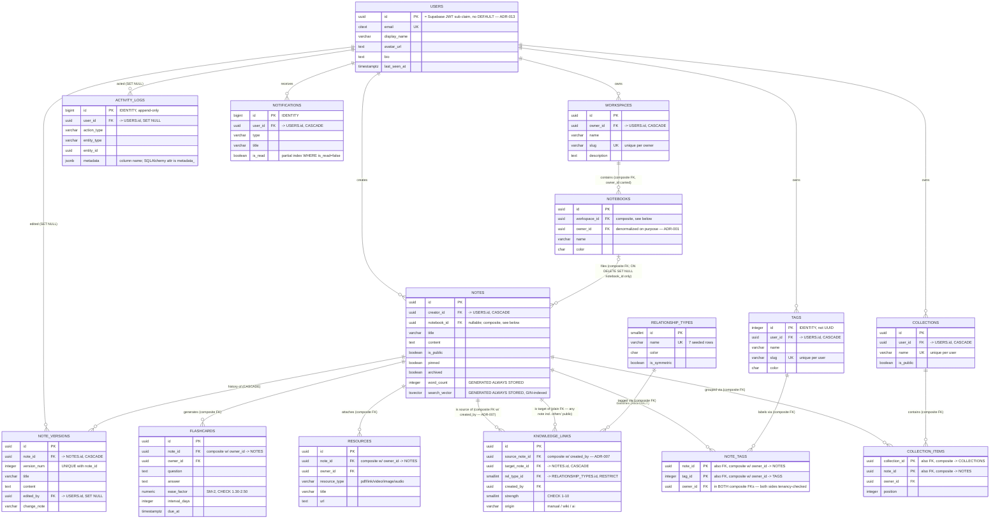
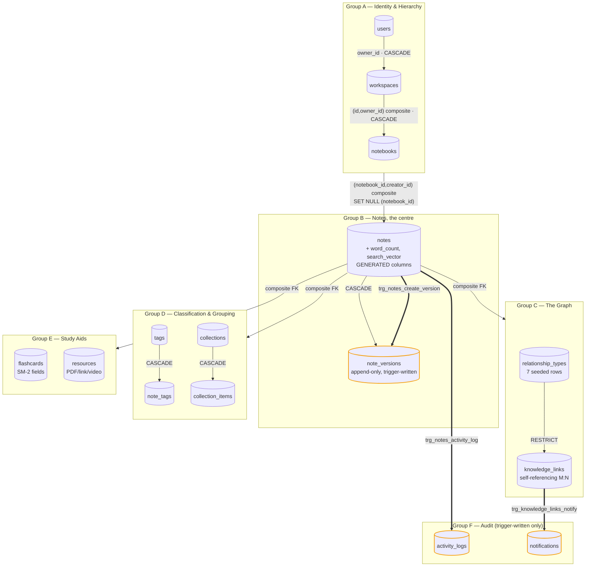
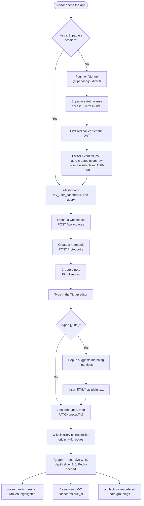
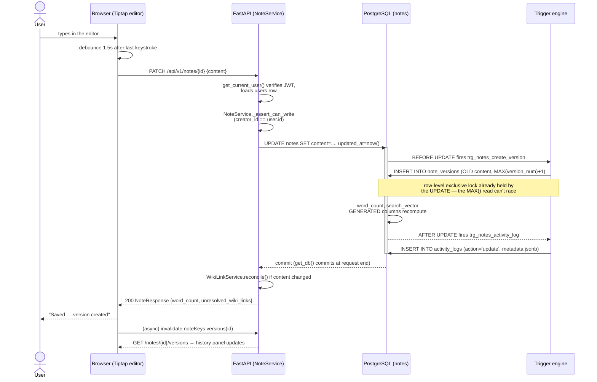
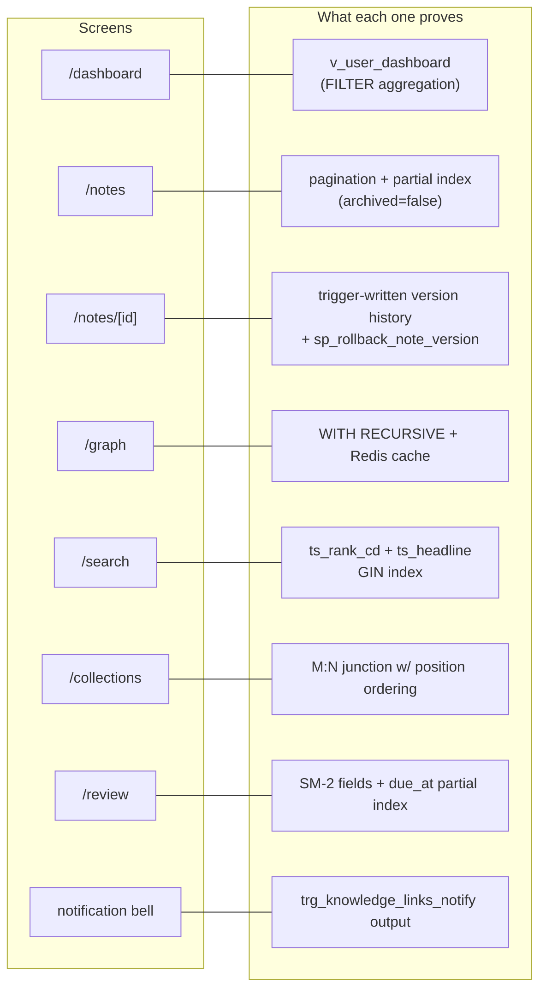

# NeuroVault — Schema, ER, and User Flow Diagrams

> Companion reference to [`02-DATABASE.md`](02-DATABASE.md) (schema), [`03-SQL-LAYER.md`](03-SQL-LAYER.md)
> (SQL layer), [`04-API.md`](04-API.md) (API contract), and [`00-ARCHITECTURE.md`](00-ARCHITECTURE.md)
> §0.4–0.5 (request/auth lifecycle). Every fact drawn here traces to one of those docs —
> see the traceability table at the bottom. Nothing here is a new design; it is the
> existing design made visual.
>
> Diagrams are [Mermaid](https://mermaid.js.org). They render natively on GitHub, in
> VS Code (Markdown Preview Mermaid Support extension), and in the published Artifact
> version of this file. If your viewer doesn't render Mermaid, paste any block into
> [mermaid.live](https://mermaid.live).

---

## 0. What this file audits and fixes

Reviewing the full `docs/phases/New/` set against itself (all 11 files) surfaced five
small but real inconsistencies — the kind Rule 1 of this doc set ("one source of truth
per fact") exists to prevent. They're fixed as part of producing this file:

| # | Where | Was | Now |
|---|---|---|---|
| 1 | `00-ARCHITECTURE.md` §0.2 system diagram | "3 triggers · 9 idx" | "3 triggers · 10 idx" — the schema has 10 indexes everywhere else it's counted |
| 2 | `README.md` "Done when" | "`\df` shows 3 routines" | "`\df` shows 6 routines" — `\df` lists the 3 trigger functions *and* the 3 standalone procedures/functions; `03-SQL-LAYER.md` and `07-DEPLOY.md` already said 6 |
| 3 | `00-ARCHITECTURE.md` §0.7 API contract | `GET /graph/connected?note_id=&depth=` | `GET /notes/{id}/graph?depth=` — the path actually implemented in `04-API.md` §4.8/§4.10 |
| 4 | `00-ARCHITECTURE.md` §0.7 API contract | `POST /uploads/image` (a backend route) | removed, replaced with a note that uploads go browser → Supabase Storage directly (`07-DEPLOY.md` §7.5), matching what the rest of the doc set already says |
| 5 | `04-API.md` | `GET /dashboard` was promised by the architecture contract and used by `05-FRONTEND.md` §5.10 and the `08-VIVA.md` demo script, but no route, service, or schema for it existed anywhere in Phase 4 | added §4.8a — `DashboardResponse`, `DashboardRepository`, `DashboardService`, the route, and its row in the §4.10 authorization table |

None of these were fatal — a careful reader would reconcile them the same way while
building. But #5 was a real gap: without it, Phase 5's `/dashboard` page and the second
minute of the demo script had nothing to call. The other four were stale numbers and a
stale path left over from the doc's own first draft (§0.7 in the old `PHASE_0` file has
the identical `/graph/connected` and `/uploads/image` lines — they were carried forward
without being reconciled against the final Phase 4 design).

Everything else in the New set held up under a full line-by-line read: the ADR list is
internally consistent, the 15-table count, 4-view count, and 3-trigger count agree
everywhere, and every SQL claim in `03-SQL-LAYER.md` matches the DDL it describes.

---

## 1. Entity–Relationship Diagram

All 15 tables. `PK` = primary key, `FK` = foreign key, `UK` = unique constraint. Composite
foreign keys (the tenancy mechanism from ADR-001) are called out in the relationship
labels, not just the attribute list — that composite-FK shape *is* the design's central
idea and is worth seeing on the diagram, not just in the DDL.



**Reading the two `NOTES ||--o{ KNOWLEDGE_LINKS` lines together is the whole graph
design.** `knowledge_links` is a self-referencing many-to-many junction on `notes` — two
foreign keys, both pointing back at the same table. The asymmetry between them (source
is a composite FK requiring `created_by`, target is a plain FK) *is* the security model
from ADR-007: you may only draw an edge out of a note you own, but you may point it at
any note you can read, including someone else's public one.

**`NOTEBOOKS |o--o{ NOTES`** uses the zero-or-one marker on the notebook side because
`notebook_id` is nullable — a note can exist unfiled. Deleting a notebook nulls
`notebook_id` on its notes rather than deleting them (PostgreSQL 15's column-list
`SET NULL`, §2.4 of `02-DATABASE.md`).

**Every relationship into `NOTES`, `NOTEBOOKS`, `NOTE_TAGS`, and `COLLECTION_ITEMS`
carries an owner/creator column that's part of a *composite* foreign key** — that's
ADR-001, tenancy enforced by the database rather than by application code. It's the
single idea worth being able to point at and explain unprompted in a viva.

---

## 2. Physical Schema Diagram — table groups and the SQL layer

The ER diagram shows entities and relationships. This shows the schema the way
`02-DATABASE.md` §2.4 groups it (Identity/Hierarchy → Notes → Graph → Classification →
Study aids → Audit), plus what the SQL layer (`03-SQL-LAYER.md`) attaches to each group —
which views read it, which triggers write to it, and where the GIN/partial indexes sit.



**Legend — what's attached to which table, per `03-SQL-LAYER.md`:**

| Object | Type | Table(s) | Purpose |
|---|---|---|---|
| `idx_notes_search_vector` | GIN | notes | full-text search |
| `idx_notes_creator_id_updated_at` | partial B-tree | notes | "my notes, newest first" |
| `idx_knowledge_links_source_note_id` / `_target_note_id` | B-tree | knowledge_links | recursive traversal, both directions |
| `idx_note_versions_note_id_version_num` | B-tree | note_versions | latest-version lookups |
| `idx_notifications_user_id_created_at` | partial B-tree | notifications | unread bell badge |
| `idx_notes_notebook_id` | partial B-tree | notes | notes within a notebook |
| `idx_flashcards_owner_id_due_at` | B-tree | flashcards | cards due for review |
| `idx_notes_title_trgm` | GIN + trigram | notes | fuzzy/typo title search |
| `idx_knowledge_links_source_note_id_origin` | B-tree | knowledge_links | wiki-link reconciliation |
| `v_note_graph_stats` | view | notes, knowledge_links, note_versions | per-note degree/version stats |
| `v_note_search` | view | notes | search result shaping |
| `v_user_dashboard` | view | users, notes, workspaces, knowledge_links | Phase 4 §4.8a's `/dashboard` |
| `v_orphan_notes` | view | notes, knowledge_links | notes connected to nothing |
| `trg_notes_create_version` | trigger (BEFORE UPDATE) | notes → note_versions | auto-versioning |
| `trg_knowledge_links_notify` | trigger (AFTER INSERT) | knowledge_links → notifications | "someone linked your note" |
| `trg_notes_activity_log` | trigger (AFTER I/U/D) | notes → activity_logs | audit trail |
| `sp_rollback_note_version` | procedure | notes, note_versions | restore + re-version |
| `fn_max_graph_depth` | function | notes, knowledge_links | recursive CTE, depth only |
| `fn_shortest_path` | function | notes, knowledge_links | recursive CTE, BFS shortest path |

---

## 3. User Flow Diagrams

### 3.1 New user → first working graph



### 3.2 Sequence — editing a note (the flagship demo)

Grounded in `00-ARCHITECTURE.md` §0.4 and the versioning trigger in `03-SQL-LAYER.md`
§3.4. This is the single flow every phase of the build points back to.



**The point this diagram makes visible:** nothing in `app/` ever inserts into
`note_versions` or `activity_logs`. Both rows exist because of what PostgreSQL did
*inside the same UPDATE statement*, which is also why a rollback (an ordinary `UPDATE`
run by `sp_rollback_note_version`) is itself versioned — see §3.3.

### 3.3 Sequence — creating a knowledge link (manual or wiki) → notification

```mermaid
sequenceDiagram
    actor U as User (owns note A)
    participant FE as Browser
    participant API as FastAPI (LinkService / WikiLinkService)
    participant DB as PostgreSQL

    alt Manual link
        U->>FE: opens link dialog, picks note B + relationship type
        FE->>API: POST /api/v1/links {source: A, target: B, rel_type_id}
    else Wiki-link
        U->>FE: types [[B's title]] in note A, saves
        FE->>API: PATCH /api/v1/notes/{A}  {content}
        API->>API: WikiLinkService resolves title -> note B's id
    end
    API->>API: assert A.creator_id == current user (ADR-007)
    API->>DB: INSERT INTO knowledge_links (source=A, target=B, created_by=user, origin=...)
    activate DB
    DB->>DB: composite FK (source_note_id, created_by) -> notes(id, creator_id)<br/>rejects it if the user doesn't own A
    DB->>DB: AFTER INSERT fires trg_knowledge_links_notify
    alt B's owner != A's owner
        DB->>DB: INSERT INTO notifications (user_id = B's owner, type='link_created')
    else B's owner == A's owner
        DB->>DB: guard trips — no notification (no self-notify)
    end
    deactivate DB
    DB-->>API: commit
    API->>API: invalidate graph:{A's owner}:* in Redis
    API-->>FE: 201 (manual) or updated NoteResponse (wiki)
    Note over FE: Graph canvas re-fetches; new edge appears<br/>with the relationship's colour and arrow style
```

### 3.4 Screens reachable per backend capability

Matches `05-FRONTEND.md` §5.10 — every backend feature has a screen, and every screen
demonstrates a specific piece of SQL.



---

## 4. Traceability — every diagram fact, back to its source doc

| Diagram element | Source |
|---|---|
| 15 tables, groups A–F | `02-DATABASE.md` §2.4 |
| Composite FK tenancy pattern | `00-ARCHITECTURE.md` ADR-001; `02-DATABASE.md` §2.3 Principle 1 |
| `knowledge_links` asymmetric source/target FK | `00-ARCHITECTURE.md` ADR-007; `02-DATABASE.md` Group C |
| Generated columns (`word_count`, `search_vector`) | `00-ARCHITECTURE.md` ADR-002; `02-DATABASE.md` §2.3 Principle 2 |
| `notebook_id` SET NULL, column-list form | `02-DATABASE.md` §2.4 Group B, `notes` table |
| 10 indexes, 4 views, 3 triggers, 3 routines | `03-SQL-LAYER.md` §3.2–§3.5 |
| Versioning trigger not a race | `03-SQL-LAYER.md` §3.4 T1 |
| Notification trigger self-notify guard | `03-SQL-LAYER.md` §3.4 T2 |
| Recursive CTE mechanics | `03-SQL-LAYER.md` §3.6 |
| `/dashboard` route (added by this review) | `04-API.md` §4.8a |
| Wiki-link reconciliation (`origin` column) | `04-API.md` §4.9 |
| Request lifecycle (edit-note sequence) | `00-ARCHITECTURE.md` §0.4 |
| Auth flow | `00-ARCHITECTURE.md` §0.5 |
| Screens ↔ SQL mapping | `05-FRONTEND.md` §5.10 |
| Demo script ordering | `08-VIVA.md` §8.4 |

If a future edit changes one of these facts, update the source doc first — this file is
downstream of all eleven, by the same one-source-of-truth rule they use on each other.
